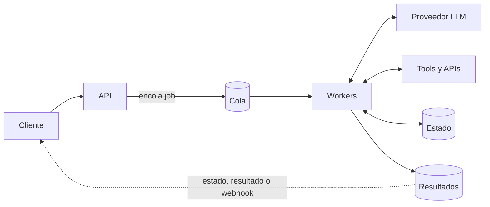
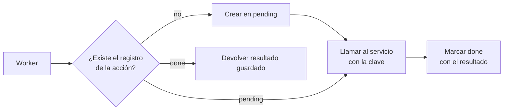

**Objetivo:** saber qué piezas tiene un servicio con LLM en producción y por qué un agente casi nunca puede atender todo dentro de un request HTTP.

## Idea

Una llamada a un LLM tarda segundos. Un agente que encadena varias llamadas y tools tarda decenas de segundos o minutos, y si espera una aprobación humana puede tardar días. Eso choca con cómo funciona la web: los load balancers y gateways cortan requests largos, los clientes se desconectan y los deploys reinician procesos.

La respuesta es separar **recibir el pedido** de **hacer el trabajo**.

### Dos formas de atender un pedido

| | Sincrónico (con streaming) | Asincrónico (jobs) |
|---|---|---|
| Cómo | El cliente espera en la misma conexión; la respuesta llega por SSE o WebSocket | El API encola un job y devuelve un id; un worker lo procesa; el cliente consulta o recibe un webhook |
| Para qué | Chat, respuestas de una o dos llamadas al modelo | Agentes con muchos pasos, procesamiento de documentos, tareas con aprobación |
| Riesgo | Si la conexión se corta, se pierde el trabajo | Más piezas para operar |

Muchos productos combinan ambos: chat sincrónico con streaming, y las acciones largas del agente como jobs.

### Las piezas



| Pieza | Responsabilidad |
|---|---|
| **API** | Autenticar, validar, encolar, devolver el id del job. Rápida y sin estado |
| **Cola** | Desacoplar la carga, reintentar, absorber picos (SQS, Redis, RabbitMQ) |
| **Workers** | Correr el agente. Escalan según el largo de la cola |
| **Estado** | El checkpoint del agente: permite retomar después de un crash, un deploy o una aprobación |
| **Resultados** | Lo que el cliente consulta o recibe por webhook |

### Propiedades que importan

- **Idempotencia**: una cola entrega mensajes *al menos una vez*. Si un worker procesa dos veces el mismo job, no puede emitir dos reembolsos. Cada job tiene un id y las acciones con efectos se registran por ese id.
- **Durabilidad**: el estado del agente no vive en memoria del proceso. Cada paso se guarda; un worker nuevo retoma donde quedó (es el checkpointer del módulo de Orquestación de agentes).
- **Timeouts explícitos**: por llamada al modelo, por tool y por job completo. Un job que excede su presupuesto de tiempo o de pasos se corta y se marca como fallido.
- **Dead letter queue**: los mensajes que fallan varias veces van a una cola aparte para inspección, en vez de reintentarse para siempre.
- **Backpressure**: la cantidad de workers limita cuántas llamadas concurrentes se hacen al proveedor, lo que protege los rate limits.

## Cómo se implementa

El API recibe el pedido, lo guarda y lo encola. No llama al modelo.

```python
import json
import uuid

import boto3
from fastapi import FastAPI
from pydantic import BaseModel

app = FastAPI()
sqs = boto3.client("sqs")
jobs = boto3.resource("dynamodb").Table("agent-jobs")
QUEUE_URL = "https://sqs.us-east-1.amazonaws.com/123456789012/agent-jobs"

class TaskRequest(BaseModel):
    customer_id: str
    instruction: str

@app.post("/tasks", status_code=202)
def create_task(req: TaskRequest) -> dict:
    job_id = str(uuid.uuid4())
    jobs.put_item(Item={"job_id": job_id, "status": "queued", **req.model_dump()})
    sqs.send_message(QueueUrl=QUEUE_URL, MessageBody=json.dumps({"job_id": job_id}))
    return {"job_id": job_id, "status_url": f"/tasks/{job_id}"}

@app.get("/tasks/{job_id}")
def get_task(job_id: str) -> dict:
    return jobs.get_item(Key={"job_id": job_id}).get("Item", {"status": "not_found"})
```

El worker lee de la cola, corre el agente y borra el mensaje solo si terminó. Si el proceso muere a mitad de camino, el mensaje vuelve a la cola y otro worker lo retoma desde el último checkpoint.

```python
def worker_loop() -> None:
    while True:
        batch = sqs.receive_message(QueueUrl=QUEUE_URL, MaxNumberOfMessages=5, WaitTimeSeconds=20)
        for msg in batch.get("Messages", []):
            job_id = json.loads(msg["Body"])["job_id"]
            jobs.update_item(Key={"job_id": job_id}, UpdateExpression="SET #s = :s",
                             ExpressionAttributeNames={"#s": "status"}, ExpressionAttributeValues={":s": "running"})
            result = run_agent(job_id)                    # resumes from its checkpoint if one exists
            jobs.update_item(Key={"job_id": job_id}, UpdateExpression="SET #s = :s, #r = :r",
                             ExpressionAttributeNames={"#s": "status", "#r": "result"},
                             ExpressionAttributeValues={":s": "done", ":r": result})
            sqs.delete_message(QueueUrl=QUEUE_URL, ReceiptHandle=msg["ReceiptHandle"])
```

> [!TIP]
> El mismo diseño funciona con Celery o RQ sobre Redis, o con funciones serverless consumiendo la cola. Lo que no cambia: API sin estado, cola, workers idempotentes y estado persistido.

## Errores comunes

- Correr el agente dentro del request HTTP: funciona en la demo y falla con el primer job largo o el primer deploy.
- Borrar el mensaje de la cola antes de terminar el trabajo: un crash lo pierde.
- Workers que no son idempotentes: un reintento duplica acciones con efectos.
- Estado del agente en memoria: un reinicio pierde todas las conversaciones en curso.
- Sin límite de concurrencia: un pico de tráfico se convierte en una tormenta de 429 del proveedor.

### Cómo diseñar un worker idempotente

Un worker es idempotente si procesar el mismo job dos veces deja el mundo igual que procesarlo una. No hace falta que todo el trabajo sea idempotente: volver a llamar al modelo o releer un documento no rompe nada. Lo que hay que proteger son las **acciones con efectos**: cobrar, reembolsar, mandar un mail, crear un ticket.

La receta tiene tres partes:

1. **Una clave por acción.** Cada acción con efectos recibe un id estable que sale del job y del paso, por ejemplo `job_id:paso:reembolso`. Un reintento genera la misma clave; una acción nueva genera otra.
2. **Un registro de acciones, escrito de forma atómica.** Antes de actuar, el worker intenta crear el registro de esa clave con una escritura condicional ("creá solo si no existe"). La base garantiza que entre dos workers solo uno gana. Si el registro ya existe y dice `done`, el worker devuelve el resultado guardado sin repetir la acción.
3. **La misma clave hacia afuera.** Si el worker se cae entre "registré que voy a actuar" y "terminé", el reintento va a encontrar el registro en `pending` sin saber si la acción llegó a ejecutarse. Por eso la clave se le pasa también al servicio externo como *idempotency key*: un id que el servicio usa para reconocer un pedido repetido y devolver la respuesta original en vez de ejecutarlo de nuevo. Si el servicio no acepta una clave, el worker consulta primero si la acción ya ocurrió (por ejemplo, si ya existe un reembolso para ese pedido) antes de reintentarla.



```python
from botocore.exceptions import ClientError

actions = boto3.resource("dynamodb").Table("agent-actions")

def refund_once(job_id: str, step: int, order_id: str, amount: int) -> dict:
    action_id = f"{job_id}:{step}:refund"
    try:
        actions.put_item(Item={"action_id": action_id, "status": "pending"},
                         ConditionExpression="attribute_not_exists(action_id)")  # only one worker creates it
    except ClientError as e:
        if e.response["Error"]["Code"] != "ConditionalCheckFailedException":
            raise
        existing = actions.get_item(Key={"action_id": action_id})["Item"]
        if existing["status"] == "done":
            return existing["result"]                     # already executed: do not repeat
    result = payments.refund(order_id, amount, idempotency_key=action_id)  # provider deduplicates
    actions.update_item(Key={"action_id": action_id}, UpdateExpression="SET #s = :s, #r = :r",
                        ExpressionAttributeNames={"#s": "status", "#r": "result"},
                        ExpressionAttributeValues={":s": "done", ":r": result})
    return result
```

Las tools del agente que tienen efectos se envuelven así; el resto del agente puede reintentarse libremente porque el checkpoint y este registro evitan que se repita lo que ya pasó.

## Preguntas de repaso

- **¿Por qué separar API y workers en un servicio con agentes?** Porque el trabajo dura más de lo que una conexión HTTP tolera; el API responde rápido con un id y los workers procesan con reintentos, escalado propio y estado persistido.
- **¿Qué significa que una cola entregue "al menos una vez"?** Que un mensaje puede procesarse más de una vez; los workers tienen que ser idempotentes.
- **¿Para qué sirve una dead letter queue?** Para apartar mensajes que fallan repetidamente y poder inspeccionarlos sin bloquear ni reintentar indefinidamente.
- **¿Cómo retomás un agente después de un crash?** Con un checkpoint persistido por paso: el worker que toma el job carga el estado y sigue desde el último paso completado.
