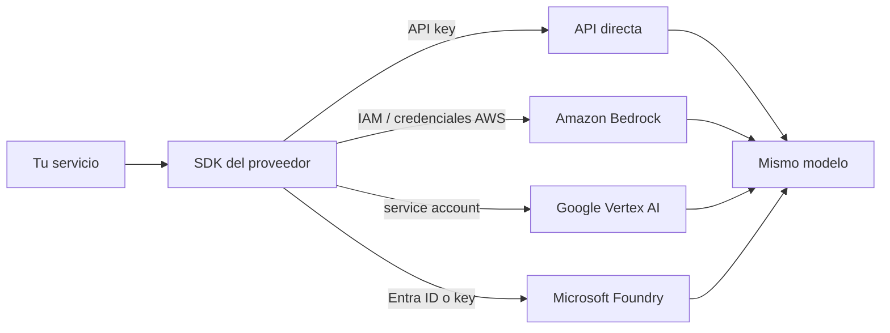

**Objetivo:** entender por qué las empresas consumen modelos a través de su cloud (Amazon Bedrock, Google Vertex AI, Microsoft Foundry) y cómo cambia el código respecto de la API directa del proveedor.

## Idea

Un mismo modelo (por ejemplo Claude) se puede consumir de dos formas:

- **API directa del proveedor**: cuenta y API key de Anthropic, OpenAI, etc.
- **A través de un cloud**: el modelo se ofrece dentro de AWS, Google Cloud o Azure, y se factura y administra como cualquier otro servicio de esa cuenta.

En empresas, la segunda es muy común por razones que no son técnicas sino de gobierno:

| Motivo | Qué resuelve el cloud |
|---|---|
| **Identidad y permisos** | Acceso con IAM / service accounts / Entra ID, sin API keys sueltas. Permisos por rol y por modelo |
| **Red privada** | Tráfico por endpoints privados de la VPC, sin salir a internet |
| **Residencia de datos** | Elegir la región donde se procesa la información |
| **Compras y facturación** | Va contra el contrato y los créditos que la empresa ya tiene con ese cloud |
| **Cumplimiento** | Auditoría, logs y certificaciones del cloud que el área de seguridad ya aprobó |
| **Servicios alrededor** | Guardrails, knowledge bases, evaluación y agentes administrados del mismo cloud |

El costo de esta comodidad: las funcionalidades nuevas del modelo a veces llegan antes a la API directa, los nombres de modelo cambian por plataforma y la autenticación es la del cloud.



### Diseñar para cambiar de plataforma

El código del agente no debería saber por dónde llega el modelo. Una función que construye el cliente según la configuración, y el resto del código usa siempre la misma interfaz (`messages.create`). Así se puede mover tráfico entre la API directa y un cloud, o usar uno como respaldo del otro (capítulo de resiliencia).

## Cómo se implementa

El SDK de Anthropic tiene un cliente por plataforma con la misma interfaz. Mismo pedido en todas las tabs:

:::tabs
== Amazon Bedrock
Autenticación con las credenciales de AWS del entorno (rol de la Lambda, del contenedor o perfil local). El id del modelo lleva el prefijo del proveedor.

```python
from anthropic import AnthropicBedrockMantle

client = AnthropicBedrockMantle(aws_region="us-east-1")

response = client.messages.create(
    model="anthropic.claude-opus-5-5",
    max_tokens=1024,
    messages=[{"role": "user", "content": "Summarize ticket T-1 in one sentence."}],
)
print(next(b.text for b in response.content if b.type == "text"))
```

Bedrock también expone la **Converse API** de boto3, una interfaz común para todos los modelos del catálogo de Bedrock:

```python
import boto3

bedrock = boto3.client("bedrock-runtime", region_name="us-east-1")
response = bedrock.converse(
    modelId="anthropic.claude-opus-5-5",
    messages=[{"role": "user", "content": [{"text": "Summarize ticket T-1 in one sentence."}]}],
    inferenceConfig={"maxTokens": 1024},
)
print(response["output"]["message"]["content"][0]["text"])
```
== Google Vertex AI
Autenticación con las credenciales de Google Cloud (service account o application default credentials). Se indica proyecto y región.

```python
from anthropic import AnthropicVertex

client = AnthropicVertex(project_id="acme-prod", region="global")

response = client.messages.create(
    model="claude-opus-5-5",
    max_tokens=1024,
    messages=[{"role": "user", "content": "Summarize ticket T-1 in one sentence."}],
)
print(next(b.text for b in response.content if b.type == "text"))
```
== Microsoft Foundry
El modelo se despliega en un recurso de Foundry en Azure. Autenticación con key del recurso o con Entra ID.

```python
from anthropic import AnthropicFoundry

client = AnthropicFoundry(resource="acme-ai-foundry", api_key=foundry_key)

response = client.messages.create(
    model="claude-opus-5-5",
    max_tokens=1024,
    messages=[{"role": "user", "content": "Summarize ticket T-1 in one sentence."}],
)
print(next(b.text for b in response.content if b.type == "text"))
```
== Anthropic
API directa: API key de Anthropic.

```python
from anthropic import Anthropic

client = Anthropic()

response = client.messages.create(
    model="claude-opus-5-5",
    max_tokens=1024,
    messages=[{"role": "user", "content": "Summarize ticket T-1 in one sentence."}],
)
print(next(b.text for b in response.content if b.type == "text"))
```
:::

Una fábrica de clientes deja el resto del código igual para cualquier plataforma:

```python
from anthropic import Anthropic, AnthropicBedrockMantle, AnthropicVertex

MODELS = {"anthropic": "claude-opus-5-5", "bedrock": "anthropic.claude-opus-5-5", "vertex": "claude-opus-5-5"}

def make_client(platform: str):
    if platform == "bedrock":
        return AnthropicBedrockMantle(aws_region="us-east-1")
    if platform == "vertex":
        return AnthropicVertex(project_id="acme-prod", region="global")
    return Anthropic()

client, model = make_client(settings.platform), MODELS[settings.platform]
```

## Errores comunes

- API keys de proveedores circulando en una empresa que ya tiene Bedrock o Vertex aprobado por seguridad.
- Código del agente lleno de condicionales por plataforma en vez de una fábrica de clientes.
- Asumir que el id del modelo es el mismo en todas las plataformas.
- Elegir región sin mirar dónde pueden procesarse los datos de los clientes.

## Preguntas de repaso

- **¿Por qué usar un modelo a través de Bedrock o Vertex en vez de la API directa?** Por identidad y permisos del cloud, red privada, residencia de datos, facturación centralizada y cumplimiento ya aprobado.
- **¿Qué es la Converse API de Bedrock?** Una interfaz común de boto3 para conversar con cualquier modelo del catálogo de Bedrock con el mismo formato de mensajes.
- **¿Cómo hacés que el código no dependa de la plataforma?** Construyendo el cliente en un solo lugar según configuración y usando siempre la misma interfaz de mensajes.
