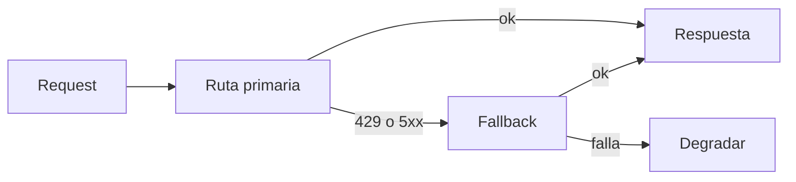

**Objetivo:** mantener un servicio con LLM disponible y dentro de presupuesto cuando el proveedor falla, el tráfico sube o un agente entra en loop.

## Idea

Un servicio con LLM depende de una API externa con rate limits, latencia variable e incidentes, y su costo crece con el uso de forma directa. Hay que diseñar para tres cosas: **que no se caiga**, **que no se dispare el gasto** y **que un cliente no afecte a los demás**.

### Fallas y respuestas

| Falla | Señal | Respuesta |
|---|---|---|
| Rate limit | 429 | Backoff con jitter, respetar `retry-after`, reducir concurrencia |
| Sobrecarga o error del proveedor | 5xx, 529 | Reintento acotado y después **fallback** a otra región, plataforma o modelo |
| Latencia alta | Requests que exceden el SLO | Timeouts por llamada; modelo más rápido para la ruta crítica |
| Incidente prolongado | Errores sostenidos | **Circuit breaker**: dejar de llamar por un rato y degradar (respuesta cacheada, cola, mensaje al usuario) |
| Agente en loop | Muchos pasos o tokens en un job | Tope de pasos, de tokens y de costo por job |
| Cliente abusivo | Un tenant consume desproporcionado | Rate limit y presupuesto por tenant |

### Fallback



*Fallback*: el mismo modelo por otra plataforma o región. *Degradar*: encolar el pedido o avisar al usuario.

El fallback más común es **el mismo modelo por otro camino** (API directa ↔ Bedrock ↔ Vertex, u otra región), porque mantiene la calidad. Cambiar a otro modelo requiere que ese modelo haya pasado las mismas evals.

### Presupuestos

- **Por request / job**: tope de tokens de salida, de pasos del agente y de costo estimado.
- **Por tenant o usuario**: cuota diaria o mensual; al superarla, se bloquea o se degrada a un modelo más barato.
- **Global**: alertas y límites de gasto en la cuenta del proveedor o del cloud.

El costo se calcula con el `usage` de cada respuesta (tokens de entrada, salida y cache) por el precio del modelo, y se registra por tenant y por feature.

### Palancas de costo

Prompt caching del prefijo estable, contexto más chico, batch para lo asincrónico, effort bajo donde alcanza, y modelos más chicos validados con evals (ver el módulo de Fundamentos de LLMs).

## Cómo se implementa

Fallback entre plataformas para el mismo modelo. El SDK ya reintenta errores transitorios; el wrapper solo decide a dónde ir después:

```python
import anthropic
from anthropic import Anthropic, AnthropicBedrockMantle

PRIMARY = (Anthropic(max_retries=2), "claude-opus-5-5")
SECONDARY = (AnthropicBedrockMantle(aws_region="us-east-1", max_retries=2), "anthropic.claude-opus-5-5")

def create_with_fallback(**kwargs):
    last_error = None
    for client, model in (PRIMARY, SECONDARY):
        try:
            return client.messages.create(model=model, **kwargs)
        except (anthropic.RateLimitError, anthropic.OverloadedError, anthropic.InternalServerError,
                anthropic.APIConnectionError) as e:
            last_error = e                     # transient: try the next route
    raise last_error
```

Concurrencia acotada hacia el proveedor dentro de un worker asincrónico:

```python
import asyncio
from anthropic import AsyncAnthropic

client = AsyncAnthropic()
llm_slots = asyncio.Semaphore(8)               # at most 8 in-flight calls per worker

async def call_llm(**kwargs):
    async with llm_slots:
        return await client.messages.create(**kwargs)
```

Presupuesto por tenant con Redis: se descuenta lo consumido y se bloquea al pasar la cuota del día.

```python
import datetime
import redis

r = redis.Redis()
DAILY_BUDGET_USD = {"starter": 5.0, "business": 50.0}
PRICE_PER_MTOK = {"input": 4.0, "output": 20.0}

def charge(tenant_id: str, plan: str, usage) -> None:
    cost_micro_usd = int(usage.input_tokens * PRICE_PER_MTOK["input"] + usage.output_tokens * PRICE_PER_MTOK["output"])
    key = f"spend:{tenant_id}:{datetime.date.today()}"
    spent = r.incrby(key, cost_micro_usd)
    r.expire(key, 2 * 86400)
    if spent / 1e6 > DAILY_BUDGET_USD[plan]:
        raise BudgetExceeded(tenant_id)
```

Tope de pasos y de tokens por job dentro del loop del agente:

```python
MAX_STEPS, MAX_OUTPUT_TOKENS = 15, 60_000

def run_agent(job) -> str:
    used = 0
    for step in range(MAX_STEPS):
        response = create_with_fallback(max_tokens=4096, messages=job.messages, tools=TOOLS)
        used += response.usage.output_tokens
        charge(job.tenant_id, job.plan, response.usage)
        if used > MAX_OUTPUT_TOKENS:
            return job.fail("token budget exceeded")
        if response.stop_reason != "tool_use":
            return job.finish(response)
        job.messages += execute_tools(response)
    return job.fail("step limit reached")
```

## Errores comunes

- Fallback a un modelo distinto que nunca pasó las evals: la calidad cambia sin que nadie lo note.
- Reintentos sin límite que multiplican la carga durante un incidente del proveedor.
- Un único presupuesto global: un cliente se come la cuota de todos.
- Medir costo por request y no por job o tarea completada.
- Timeouts del cliente más largos que los del gateway que tiene adelante.

## Preguntas de repaso

- **¿Cómo hacés resiliente un servicio que depende de un proveedor LLM?** Reintentos acotados con backoff, timeouts, fallback al mismo modelo por otra plataforma o región, circuit breaker y degradación controlada.
- **¿Cómo controlás el costo por cliente?** Midiendo `usage` por tenant, con cuotas por plan, topes por job y alertas de gasto.
- **¿Qué es un circuit breaker?** Un mecanismo que, tras muchas fallas seguidas, deja de llamar a la dependencia durante un tiempo y responde degradado, para no empeorar el incidente.
- **¿Por qué limitar la concurrencia hacia el proveedor?** Para quedarse dentro de los rate limits y evitar tormentas de 429 que aumentan latencia y reintentos.
