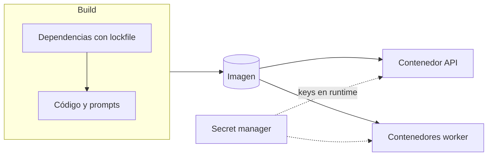

**Objetivo:** armar la imagen de un servicio con LLM pensando en lo que lo hace distinto de una API común: procesos largos, streaming, secretos de proveedores y workers.

## Idea

Un agente se empaqueta como cualquier servicio Python, con algunas decisiones propias:

| Decisión | Por qué importa en un servicio con LLM |
|---|---|
| **Una imagen, varios procesos** | API y workers usan el mismo código; cambia el comando. Así nunca quedan versiones distintas del prompt o de las tools |
| **Secretos en runtime** | Las API keys de proveedores nunca van en la imagen: se inyectan desde un secret manager al arrancar |
| **Apagado ordenado** | Al recibir SIGTERM, el worker deja de tomar jobs nuevos y termina (o checkpointea) el actual. Si no, un deploy corta agentes a mitad de una acción |
| **Health checks separados** | *Liveness*: el proceso responde. *Readiness*: puede atender (conexión a la cola y al estado). No dependen de que el proveedor LLM responda: si el proveedor cae, reiniciar contenedores no ayuda |
| **Streaming** | Los proxies delante del servicio no tienen que bufferear respuestas SSE |
| **Imagen chica y reproducible** | Build multi-stage, dependencias fijadas por lockfile, usuario sin privilegios |
| **Prompts y configuración versionados** | Los prompts viajan con el código (o con una versión explícita), para saber qué versión respondió cada request |



## Cómo se implementa

Dockerfile multi-stage con `uv`: la primera etapa resuelve dependencias, la final solo copia el entorno y el código, y corre como usuario sin privilegios.

```dockerfile
FROM python:3.13-slim AS build
COPY --from=ghcr.io/astral-sh/uv:latest /uv /usr/local/bin/uv
WORKDIR /app
COPY pyproject.toml uv.lock ./
RUN uv sync --frozen --no-dev --no-install-project
COPY src/ src/
COPY prompts/ prompts/
RUN uv sync --frozen --no-dev

FROM python:3.13-slim
RUN useradd --create-home app
WORKDIR /app
COPY --from=build --chown=app /app /app
ENV PATH="/app/.venv/bin:$PATH" PYTHONUNBUFFERED=1
USER app
EXPOSE 8000
CMD ["uvicorn", "agent_service.api:app", "--host", "0.0.0.0", "--port", "8000", "--timeout-graceful-shutdown", "60"]
```

API, workers y dependencias locales en un compose. El worker usa la misma imagen con otro comando y más tiempo de apagado:

```yaml
services:
  api:
    build: .
    ports: ["8000:8000"]
    env_file: .env.local
    depends_on: [redis]
    healthcheck:
      test: ["CMD", "python", "-c", "import urllib.request; urllib.request.urlopen('http://localhost:8000/healthz')"]
  worker:
    build: .
    command: ["python", "-m", "agent_service.worker"]
    env_file: .env.local
    stop_grace_period: 2m          # let the current job finish or checkpoint
    deploy: {replicas: 3}
    depends_on: [redis]
  redis:
    image: redis:8
```

El worker atiende SIGTERM: deja de pedir trabajo y termina lo que tiene en curso.

```python
import signal

stopping = False

def handle_sigterm(signum, frame) -> None:
    global stopping
    stopping = True                       # finish the current job, take no new ones

signal.signal(signal.SIGTERM, handle_sigterm)

def main() -> None:
    while not stopping:
        job = queue.receive(wait_seconds=20)
        if job:
            process(job)                  # checkpoints after every agent step
```

Endpoints de salud: readiness verifica las dependencias propias, no al proveedor del modelo.

```python
@app.get("/healthz")
def liveness() -> dict:
    return {"ok": True}

@app.get("/readyz")
def readiness() -> dict:
    redis_client.ping()                   # raises if the queue/state store is unreachable
    return {"ok": True}
```

Para respuestas por streaming detrás de nginx u otro proxy, la respuesta indica que no se bufferee:

```python
from fastapi.responses import StreamingResponse

@app.post("/chat")
def chat(req: ChatRequest) -> StreamingResponse:
    return StreamingResponse(stream_answer(req), media_type="text/event-stream",
                             headers={"Cache-Control": "no-cache", "X-Accel-Buffering": "no"})
```

## Errores comunes

- API keys copiadas en la imagen o en variables del Dockerfile: quedan en el registry y en el historial de capas.
- Readiness que llama al proveedor LLM: un incidente del proveedor reinicia toda la flota sin arreglar nada.
- Workers sin manejo de SIGTERM: cada deploy corta agentes a mitad de una acción con efectos.
- Imágenes distintas para API y worker que divergen en prompts o tools.
- Proxies que bufferean SSE: el usuario ve la respuesta entera de golpe al final.

## Preguntas de repaso

- **¿Por qué usar la misma imagen para API y workers?** Para que compartan exactamente el mismo código, prompts y tools; solo cambia el comando de arranque.
- **¿Cómo manejás los secretos de los proveedores?** Inyectados en runtime desde un secret manager, nunca en la imagen, y rotables sin rebuild.
- **¿Qué hace un worker ante un deploy?** Recibe SIGTERM, deja de tomar trabajo, termina o checkpointea el job actual dentro del período de gracia y sale.
- **¿Qué diferencia hay entre liveness y readiness?** Liveness indica que el proceso vive; readiness, que puede atender porque sus dependencias propias responden.
