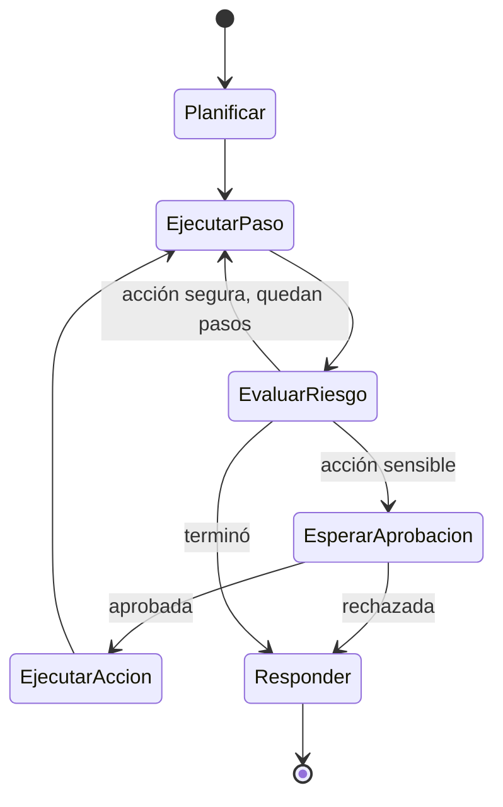

**Objetivo:** mapear cada parte de un agente a servicios serverless de AWS: Lambda para el cómputo, API Gateway para la entrada, SQS para la cola y Step Functions para flujos largos con aprobaciones.

## Idea

Serverless encaja bien con cargas irregulares y con flujos que esperan mucho: no pagás servidores mientras el agente espera una aprobación. A cambio, cada función tiene un tiempo máximo de ejecución y no guarda estado entre invocaciones.

| Servicio | Rol en un agente |
|---|---|
| **API Gateway** | Entrada HTTP: autenticación, throttling, validación. Para requests cortos |
| **Lambda** | Cómputo: el handler del API, el worker que corre un paso del agente, el que ejecuta una tool |
| **SQS** | Cola entre el API y los workers; reintentos y dead letter queue |
| **Step Functions** | Orquestación durable: pasos, reintentos, ramas, paralelismo y **esperas de horas o días** sin cómputo corriendo |
| **DynamoDB / S3** | Estado del job, checkpoints, resultados, auditoría |
| **EventBridge** | Eventos entre sistemas (job terminado, aprobación pedida) |

### Step Functions y human-in-the-loop

Una Lambda no puede quedarse esperando a que alguien apruebe. Step Functions sí: el patrón **callback con task token** pausa la ejecución, entrega un token a quien tiene que decidir, y retoma cuando ese token vuelve con la respuesta. La espera no consume cómputo.



`EsperarAprobacion` puede durar días. Cuando la persona decide (desde Slack, un panel o un mail), un backend llama a Step Functions con el token y la decisión.

## Cómo se implementa

Worker como Lambda consumiendo SQS. Con *partial batch response*, si falla un mensaje del lote solo ese vuelve a la cola:

```python
from aws_lambda_powertools import Logger
from aws_lambda_powertools.utilities.batch import BatchProcessor, EventType, process_partial_response
from aws_lambda_powertools.utilities.data_classes.sqs_event import SQSRecord

logger = Logger(service="agent-worker")
processor = BatchProcessor(event_type=EventType.SQS)

def handle_record(record: SQSRecord) -> None:
    job = record.json_body
    logger.info("running agent step", extra={"job_id": job["job_id"]})
    run_agent_step(job["job_id"])          # loads checkpoint, runs one step, saves checkpoint

@logger.inject_lambda_context
def handler(event: dict, context) -> dict:
    return process_partial_response(event=event, record_handler=handle_record,
                                    processor=processor, context=context)
```

Máquina de estados con espera de aprobación. `waitForTaskToken` pausa hasta que alguien devuelva el token:

```json
{
  "StartAt": "RunAgent",
  "States": {
    "RunAgent": {
      "Type": "Task",
      "Resource": "arn:aws:states:::lambda:invoke",
      "Parameters": {"FunctionName": "agent-step", "Payload.$": "$"},
      "OutputPath": "$.Payload",
      "Retry": [{"ErrorEquals": ["States.TaskFailed"], "MaxAttempts": 3, "BackoffRate": 2}],
      "Next": "NeedsApproval"
    },
    "NeedsApproval": {
      "Type": "Choice",
      "Choices": [{"Variable": "$.pending_action", "IsPresent": true, "Next": "WaitForApproval"}],
      "Default": "Finish"
    },
    "WaitForApproval": {
      "Type": "Task",
      "Resource": "arn:aws:states:::lambda:invoke.waitForTaskToken",
      "Parameters": {
        "FunctionName": "request-approval",
        "Payload": {"action.$": "$.pending_action", "job_id.$": "$.job_id", "task_token.$": "$$.Task.Token"}
      },
      "HeartbeatSeconds": 604800,
      "Next": "RunAgent"
    },
    "Finish": {"Type": "Succeed"}
  }
}
```

Cuando la persona decide, el backend que recibe la respuesta devuelve el token:

```python
import json
import boto3

sfn = boto3.client("stepfunctions")

def on_decision(task_token: str, approved: bool, reviewer: str, note: str) -> None:
    if approved:
        sfn.send_task_success(taskToken=task_token,
                              output=json.dumps({"approved": True, "reviewer": reviewer}))
    else:
        sfn.send_task_failure(taskToken=task_token, error="Rejected", cause=note)
```

Infraestructura como código con AWS CDK: API Gateway frente a una Lambda que encola, y una Lambda worker consumiendo la cola.

```python
from aws_cdk import Duration, Stack
from aws_cdk import aws_apigateway as apigw
from aws_cdk import aws_lambda as _lambda
from aws_cdk import aws_lambda_event_sources as events
from aws_cdk import aws_sqs as sqs

class AgentStack(Stack):
    def __init__(self, scope, construct_id, **kwargs) -> None:
        super().__init__(scope, construct_id, **kwargs)
        dlq = sqs.Queue(self, "JobsDLQ")
        jobs = sqs.Queue(self, "Jobs", visibility_timeout=Duration.minutes(16),
                         dead_letter_queue=sqs.DeadLetterQueue(queue=dlq, max_receive_count=3))
        code = _lambda.Code.from_asset("src")
        api_fn = _lambda.Function(self, "Api", runtime=_lambda.Runtime.PYTHON_3_13, code=code,
                                  handler="agent_service.api.handler", environment={"QUEUE_URL": jobs.queue_url})
        worker_fn = _lambda.Function(self, "Worker", runtime=_lambda.Runtime.PYTHON_3_13, code=code,
                                     handler="agent_service.worker.handler", timeout=Duration.minutes(15),
                                     reserved_concurrent_executions=20)   # caps parallel calls to the LLM
        jobs.grant_send_messages(api_fn)
        worker_fn.add_event_source(events.SqsEventSource(jobs, batch_size=5, report_batch_item_failures=True))
        apigw.LambdaRestApi(self, "AgentApi", handler=api_fn)
```

`reserved_concurrent_executions` es la backpressure del capítulo de arquitectura: limita cuántos workers llaman al modelo a la vez.

## Errores comunes

- Correr el agente completo dentro de la Lambda del API: choca con el timeout del gateway.
- Esperar una aprobación dentro de una Lambda: paga cómputo ocioso y muere al llegar al tiempo máximo.
- `visibility_timeout` de la cola menor que el timeout del worker: el mensaje reaparece mientras todavía se procesa y se procesa dos veces.
- Sin dead letter queue: un job que siempre falla se reintenta para siempre.
- Concurrencia de Lambda sin límite frente a un proveedor con rate limits.

## Preguntas de repaso

- **¿Cómo implementás una aprobación humana que puede tardar días en AWS?** Step Functions con `waitForTaskToken`: la ejecución se pausa sin cómputo, el token viaja a quien decide y `SendTaskSuccess` o `SendTaskFailure` la retoma.
- **¿Qué hace partial batch response en SQS + Lambda?** Reporta qué mensajes del lote fallaron para que solo esos vuelvan a la cola.
- **¿Por qué limitar la concurrencia de las Lambdas worker?** Para no superar los rate limits del proveedor y controlar el gasto.
- **¿Cuándo serverless y cuándo contenedores?** Serverless para carga irregular y flujos con esperas largas; contenedores para carga sostenida, procesos largos continuos o necesidades de GPU.
