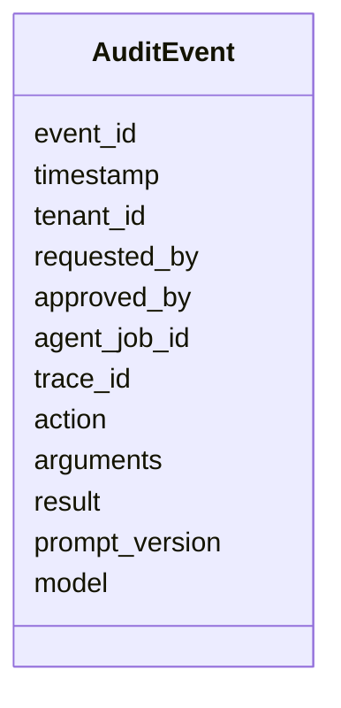

**Objetivo:** registrar lo que hace un agente de forma que se pueda depurar, explicar a un cliente y auditar quién autorizó cada acción.

## Idea

Un agente toma decisiones y ejecuta acciones en nombre de usuarios. Cuando algo sale mal ("¿por qué se reembolsaron 900 USD?"), hay que poder responder **qué pasó, quién lo pidió, quién lo aprobó y con qué datos**. Para eso hay tres registros distintos, con objetivos distintos:

| Registro | Para qué | Qué contiene | Retención |
|---|---|---|---|
| **Logs operativos** | Depurar y monitorear | Eventos estructurados con ids de correlación, errores, latencias | Días o semanas |
| **Traces** | Entender un request paso a paso | Spans de cada llamada al modelo, tool y retrieval (módulo de Evals y observabilidad) | Semanas |
| **Auditoría** | Responsabilidad y cumplimiento | Cada acción con efecto: actor, aprobador, argumentos, resultado | Meses o años, inmutable |

### Qué tiene un evento de auditoría



- **requested_by** y **approved_by** separan quién pidió de quién autorizó.
- **trace_id** conecta el evento con el trace completo para ver el razonamiento que llevó a la acción.
- **prompt_version** y **model** permiten saber qué versión del sistema tomó la decisión.

### Propiedades

- **Append-only**: los eventos no se editan ni se borran. Correcciones como eventos nuevos.
- **Idempotente**: un reintento no genera dos eventos ni dos acciones para el mismo id.
- **Separado de los logs**: los logs se rotan y se muestrean; la auditoría no.
- **Datos personales minimizados**: guardar ids y lo necesario para explicar, no conversaciones completas con datos sensibles.

### Correlación

Un `job_id` (o `trace_id`) viaja en cada log, span y evento de auditoría. Con un solo id se reconstruye todo lo que pasó en un pedido, desde el API hasta la acción en el sistema externo.

## Cómo se implementa

Logs estructurados en JSON con ids de correlación, usando Powertools for AWS Lambda:

```python
from aws_lambda_powertools import Logger

logger = Logger(service="agent-worker")

@logger.inject_lambda_context(correlation_id_path="Records[0].messageAttributes.job_id.stringValue")
def handler(event: dict, context) -> None:
    logger.append_keys(tenant_id=tenant_of(event))
    logger.info("tool call", extra={"tool": "issue_refund", "customer_id": "C-100", "amount_usd": 49})
```

Evento de auditoría inmutable en DynamoDB: la condición impide sobreescribir un evento existente, así que un reintento con el mismo id no duplica ni pisa.

```python
import datetime
import boto3
from botocore.exceptions import ClientError

audit = boto3.resource("dynamodb").Table("agent-audit")

def record_action(event_id: str, job, action: str, arguments: dict, result: dict, approved_by: str | None) -> None:
    try:
        audit.put_item(
            Item={
                "event_id": event_id,
                "timestamp": datetime.datetime.now(datetime.UTC).isoformat(),
                "tenant_id": job.tenant_id, "requested_by": job.user_id, "approved_by": approved_by,
                "agent_job_id": job.id, "trace_id": job.trace_id,
                "action": action, "arguments": arguments, "result": result,
                "prompt_version": job.prompt_version, "model": job.model,
            },
            ConditionExpression="attribute_not_exists(event_id)",
        )
    except ClientError as e:
        if e.response["Error"]["Code"] != "ConditionalCheckFailedException":
            raise                                   # already recorded: retry is a no-op
```

Acciones con efecto idempotentes: si el worker reintenta el mismo job, la segunda ejecución devuelve el resultado guardado en vez de repetir el reembolso.

```python
from aws_lambda_powertools.utilities.idempotency import (
    DynamoDBPersistenceLayer, IdempotencyConfig, idempotent_function,
)

persistence = DynamoDBPersistenceLayer(table_name="agent-idempotency")
config = IdempotencyConfig(event_key_jmespath="action_id")

@idempotent_function(data_keyword_argument="request", persistence_store=persistence, config=config)
def execute_refund(request: dict) -> dict:
    result = payments.refund(request["customer_id"], request["amount_usd"], request["reason"])
    record_action(request["action_id"], current_job(), "issue_refund", request, result, request.get("approved_by"))
    return result
```

## Errores comunes

- Usar los logs operativos como auditoría: se rotan, se muestrean y se pueden borrar.
- Registrar la acción pero no quién la aprobó ni con qué versión de prompt y modelo.
- Guardar conversaciones completas con datos personales "por las dudas".
- Ids distintos en logs, traces y auditoría: imposible reconstruir un incidente.
- Acciones con efecto sin idempotencia: un reintento de la cola duplica la operación.

## Preguntas de repaso

- **¿En qué se diferencian logs, traces y auditoría?** Los logs sirven para operar, los traces para entender un request paso a paso, y la auditoría es el registro inmutable de acciones con efecto, quién las pidió y quién las aprobó.
- **¿Qué debe tener un evento de auditoría de un agente?** Actor, aprobador, acción, argumentos, resultado, ids de correlación, y la versión de prompt y modelo que decidió.
- **¿Cómo evitás que un reintento ejecute dos veces una acción?** Con una clave de idempotencia por acción: la segunda ejecución devuelve el resultado guardado.
- **¿Cómo reconstruís un incidente?** Con un id de correlación presente en logs, traces y eventos de auditoría.
