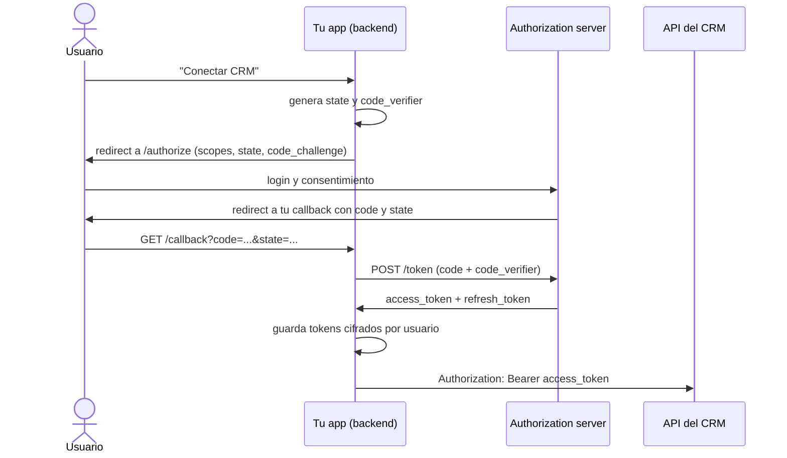

**Objetivo:** entender cómo una aplicación obtiene permiso para usar la API de otro sistema en nombre de un usuario o de sí misma, y cómo se maneja ese permiso en el tiempo.

## Idea

Cuando un agente crea un deal en el CRM de un cliente, alguien tiene que haberle dado permiso. **OAuth2** es el protocolo estándar para eso: separa a quien **es dueño** de los datos (el usuario o la empresa), a quien **los guarda** (el sistema externo) y a quien **los quiere usar** (tu aplicación), sin que tu aplicación vea nunca la contraseña del usuario.

### Los roles

| Rol | Quién es | En el ejemplo |
|---|---|---|
| **Resource owner** | El dueño de los datos | El vendedor que conecta su CRM |
| **Client** | La aplicación que pide acceso | Tu backend con el agente |
| **Authorization server** | Quien autentica y emite tokens | El login del CRM |
| **Resource server** | La API con los datos | La API del CRM |

### Tokens

- **Access token**: credencial de vida corta (minutos u horas) que se manda en cada request como `Authorization: Bearer <token>`.
- **Refresh token**: credencial de vida larga que sirve para pedir un access token nuevo sin volver a molestar al usuario. Se guarda cifrada y nunca sale del backend.
- **Scopes**: qué puede hacer el token (`deals.read`, `deals.write`). Pedí solo los que el agente necesita: si el agente solo lee, el token no tiene que poder escribir.

### Los flujos que importan

| Flujo | Quién actúa | Cuándo |
|---|---|---|
| **Authorization code + PKCE** | La app en nombre de un **usuario** | El usuario conecta su cuenta (botón "Conectar con Salesforce") |
| **Client credentials** | La app **como sí misma** (service account) | Integraciones servidor a servidor, sin usuario presente |
| **Refresh token** | La app, renovando acceso | Cada vez que el access token vence |
| **JWT bearer / service account con clave** | La app con una clave privada | Variante de servidor a servidor en Salesforce, Google y otros |

Implicit y password grant ya no se usan: exponen tokens o credenciales.

### Authorization code con PKCE



- **state** protege contra CSRF: la respuesta tiene que traer el mismo valor que mandaste.
- **PKCE** (`code_verifier` / `code_challenge`) impide que alguien que intercepte el `code` lo canjee: solo quien generó el verifier puede.

### En nombre de quién actúa el agente

Esta decisión define permisos y auditoría:

- **Token del usuario** (authorization code): el agente puede hacer exactamente lo que ese usuario puede. Las acciones quedan registradas a su nombre. Es lo correcto cuando el agente trabaja *para* una persona.
- **Service account** (client credentials): un usuario técnico con permisos propios. Útil para procesos en background, pero el agente puede terminar viendo datos que la persona que pidió algo no debería ver. Hay que filtrar por permisos en tu código.

> [!IMPORTANT]
> El modelo nunca ve tokens. Las tools reciben un identificador de usuario o tenant y el backend busca el token. Un token en el prompt puede terminar en logs, en una respuesta o en manos de un prompt injection.

## Cómo se implementa

Con Authlib, el cliente OAuth2 más usado en Python. Autorización con PKCE y canje del código:

```python
from authlib.common.security import generate_token
from authlib.integrations.httpx_client import OAuth2Client

AUTHORIZE_URL = "https://auth.example.com/oauth/authorize"
TOKEN_URL = "https://auth.example.com/oauth/token"

def start_connect(user_id: str) -> str:
    client = OAuth2Client(
        client_id=CLIENT_ID,
        client_secret=CLIENT_SECRET,
        scope="deals.read deals.write",
        redirect_uri="https://app.example.com/oauth/callback",
        code_challenge_method="S256",
    )
    verifier = generate_token(48)
    url, state = client.create_authorization_url(AUTHORIZE_URL, code_verifier=verifier)
    pending.save(state, user_id=user_id, verifier=verifier)    # short-lived, server side
    return url                                                  # redirect the user here

def finish_connect(callback_url: str, state: str) -> None:
    attempt = pending.pop(state)                                # unknown state -> reject
    client = OAuth2Client(client_id=CLIENT_ID, client_secret=CLIENT_SECRET,
                          redirect_uri="https://app.example.com/oauth/callback")
    token = client.fetch_token(TOKEN_URL, authorization_response=callback_url,
                               code_verifier=attempt.verifier)
    vault.save_token(attempt.user_id, token)                    # encrypted at rest
```

Cliente que renueva solo cuando el access token vence, y persiste el token nuevo:

```python
def crm_client(user_id: str) -> OAuth2Client:
    def on_refresh(token, refresh_token=None, access_token=None):
        vault.save_token(user_id, token)

    return OAuth2Client(
        client_id=CLIENT_ID,
        client_secret=CLIENT_SECRET,
        token=vault.load_token(user_id),
        token_endpoint=TOKEN_URL,
        update_token=on_refresh,        # called after an automatic refresh
    )

deals = crm_client(user_id).get("https://api.example.com/v1/deals", params={"limit": 50}).json()
```

Servidor a servidor, sin usuario:

```python
client = OAuth2Client(client_id=CLIENT_ID, client_secret=CLIENT_SECRET, scope="deals.read")
client.fetch_token(TOKEN_URL, grant_type="client_credentials")
```

## Errores comunes

- Guardar refresh tokens en texto plano o mandarlos al frontend.
- Pedir todos los scopes "por las dudas": un agente con permisos de borrado que solo necesitaba leer.
- No validar `state` en el callback.
- Usar una service account para todo y mostrarle al usuario datos que no podría ver con su propia cuenta.
- No manejar la revocación: el usuario desconecta la app y el agente sigue intentando con un refresh token inválido.
- Poner tokens en el contexto del modelo.

## Preguntas de repaso

- **¿Qué diferencia hay entre access token y refresh token?** El access token es de vida corta y se manda en cada request; el refresh token es de vida larga y solo sirve para obtener access tokens nuevos.
- **¿Para qué sirve PKCE?** Para que un `code` interceptado no se pueda canjear: el canje exige el `code_verifier` que solo conoce quien inició el flujo.
- **¿Authorization code o client credentials para un agente?** Authorization code cuando el agente actúa para un usuario y debe respetar sus permisos; client credentials para procesos de servidor sin usuario, filtrando permisos en el código.
- **¿Por qué el modelo no debe ver tokens?** Porque el contexto puede filtrarse por logs, respuestas o prompt injection; las tools resuelven credenciales del lado del servidor.
