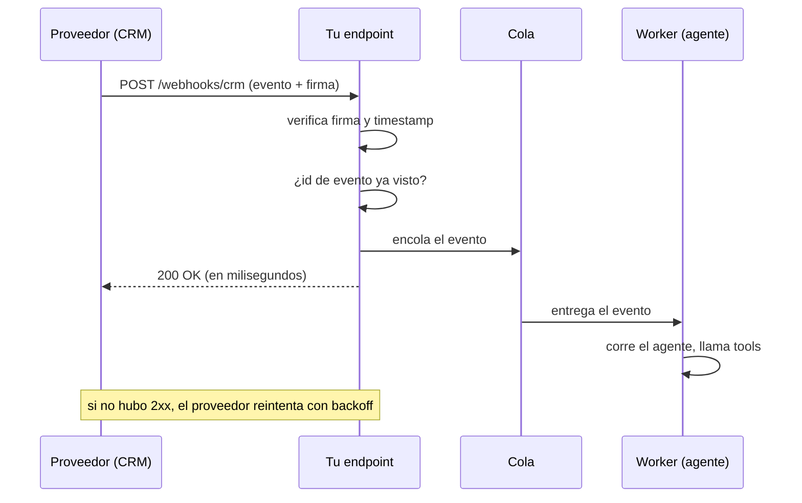

**Objetivo:** recibir eventos de sistemas externos de forma segura y confiable: verificar quién los manda, no procesarlos dos veces y no perder ninguno.

## Idea

Un **webhook** es un HTTP POST que un sistema externo le hace a tu endpoint cuando pasa algo: "se cerró un deal", "llegó un ticket", "se pagó una factura". Es la forma de reaccionar a eventos sin preguntar cada minuto (*polling*).

Para un agente, los webhooks son disparadores: llega un ticket nuevo y el agente lo clasifica, busca contexto y propone una respuesta.

### Las tres garantías que tenés que construir

| Problema | Por qué pasa | Solución |
|---|---|---|
| **Autenticidad** | Cualquiera puede hacer POST a tu URL | Verificar una **firma HMAC** del cuerpo con un secreto compartido |
| **Duplicados** | El emisor reintenta si no recibe 2xx a tiempo, o manda el mismo evento dos veces | **Idempotencia**: guardar el id del evento y descartar repetidos |
| **Pérdida y timeouts** | Procesar (por ejemplo, correr un agente) tarda más que el timeout del emisor | **Responder rápido** (2xx en milisegundos) y procesar en background desde una cola |

La mayoría de los proveedores entregan **al menos una vez** (*at-least-once*): pueden repetir, nunca deberían perder. Por eso la idempotencia no es opcional.

### Firma HMAC

El emisor calcula `HMAC-SHA256(secreto, cuerpo_crudo)` y lo manda en un header. Vos recalculás con el mismo secreto sobre los **bytes exactos** que llegaron y comparás. Si alguien modifica un carácter del cuerpo, la firma no coincide. Muchos proveedores incluyen un **timestamp** en lo firmado para que un evento viejo capturado no se pueda reenviar (*replay*): se rechaza si es más viejo que unos minutos.

### El flujo completo



### Orden y consistencia

Los eventos pueden llegar **desordenados**: el "deal actualizado" antes del "deal creado". Dos estrategias:

- Tratar el evento como una **señal** y leer el estado actual del objeto desde la API antes de actuar.
- Guardar la versión o el timestamp del objeto y descartar eventos más viejos que lo que ya procesaste.

## Cómo se implementa

Endpoint en FastAPI que verifica la firma sobre el cuerpo crudo, descarta duplicados y delega el trabajo:

```python
import hashlib
import hmac
import json
import time

from fastapi import BackgroundTasks, FastAPI, Header, HTTPException, Request

app = FastAPI()
MAX_AGE_SECONDS = 300

def valid_signature(secret: bytes, timestamp: str, raw: bytes, signature: str) -> bool:
    signed = timestamp.encode() + b"." + raw
    expected = hmac.new(secret, signed, hashlib.sha256).hexdigest()
    return hmac.compare_digest(expected, signature)        # constant-time comparison

@app.post("/webhooks/crm")
async def crm_webhook(
    request: Request,
    background: BackgroundTasks,
    x_signature: str = Header(),
    x_timestamp: str = Header(),
):
    raw = await request.body()                              # exact bytes, before parsing
    if abs(time.time() - int(x_timestamp)) > MAX_AGE_SECONDS:
        raise HTTPException(status_code=401, detail="stale event")
    if not valid_signature(WEBHOOK_SECRET, x_timestamp, raw, x_signature):
        raise HTTPException(status_code=401, detail="bad signature")

    event = json.loads(raw)
    if not await processed_events.add_if_absent(event["id"]):   # atomic insert, unique key
        return {"status": "duplicate"}

    background.add_task(handle_event, event)               # or push to a real queue
    return {"status": "accepted"}
```

`BackgroundTasks` corre la tarea en el mismo proceso después de responder: alcanza para trabajos cortos. Para correr agentes (segundos o minutos, con reintentos) se usa una cola real (SQS, Pub/Sub, Redis, RabbitMQ) y workers separados, para que un deploy o un crash no pierda eventos.

La idempotencia también va en el worker: si el agente crea algo en otro sistema, usá el id del evento como clave para no crearlo dos veces si el worker se reintenta.

```python
async def handle_event(event: dict) -> None:
    if event["type"] == "ticket.created":
        ticket = await crm.get_ticket(event["object_id"])     # read current state
        draft = await triage_agent.run(ticket)
        await crm.add_note(ticket["id"], draft, idempotency_key=f"note-{event['id']}")
```

## Errores comunes

- Verificar la firma sobre el JSON re-serializado en vez de los bytes crudos: el orden de claves o los espacios cambian y la firma falla.
- Comparar firmas con `==` en vez de comparación en tiempo constante.
- Correr el agente antes de responder: el proveedor corta por timeout, reintenta y el agente corre dos veces.
- No guardar ids de eventos: cada reintento genera una acción duplicada.
- Confiar en el orden de llegada.
- Exponer el endpoint sin firma porque "la URL es secreta".

## Preguntas de repaso

- **¿Cómo verificás que un webhook es legítimo?** Recalculando el HMAC del cuerpo crudo (y del timestamp) con el secreto compartido y comparando en tiempo constante; rechazando eventos viejos para evitar replays.
- **¿Qué significa entrega at-least-once y qué implica?** Que un evento puede llegar más de una vez; el receptor tiene que ser idempotente.
- **¿Por qué responder antes de procesar?** Porque el emisor tiene timeouts cortos; si procesás en línea, reintenta y duplicás trabajo. Se encola y se responde 2xx.
- **¿Cómo manejás eventos desordenados?** Leyendo el estado actual desde la API o comparando versiones antes de aplicar cambios.
