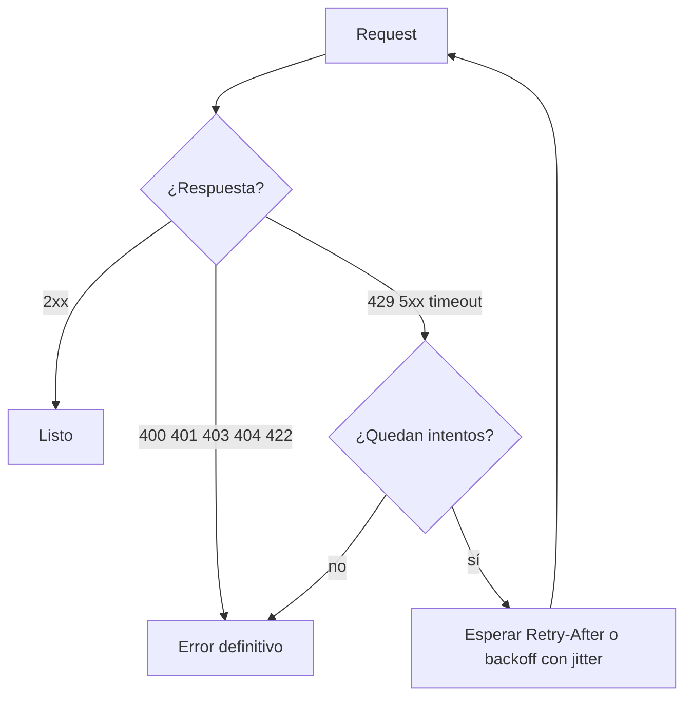

**Objetivo:** consumir APIs de terceros sin que te bloqueen, sin perder datos al paginar y sin duplicar operaciones al reintentar.

## Idea

Un agente es un cliente de APIs agresivo: puede llamar la misma tool muchas veces en segundos, en paralelo y desde varios usuarios a la vez. Las APIs de CRMs y ERPs se defienden con límites, y tu integración tiene que convivir con ellos.

### Rate limits

| Tipo | Ejemplo | Cómo se ve |
|---|---|---|
| Por ventana de tiempo | 100 requests cada 10 segundos | `429 Too Many Requests` |
| Diario o mensual | 250.000 llamadas por día por cuenta | 429 o 403 hasta que se reinicia |
| Concurrencia | Máximo 10 requests simultáneos | 429 o errores de conexión |
| Por costo | Consultas pesadas consumen más cupo | Headers de cupo restante |

Las APIs suelen informar el estado en headers: `Retry-After` (cuánto esperar), y variantes de `X-RateLimit-Limit` / `X-RateLimit-Remaining` / `X-RateLimit-Reset`. Usarlos es mejor que adivinar.

Dos estrategias complementarias:

- **Reactiva**: cuando llega un 429, esperar y reintentar.
- **Preventiva**: limitar tu propio ritmo antes de llegar al límite (un *token bucket* o un semáforo por cuenta), sobre todo con varios workers o agentes en paralelo. El cupo es de la **cuenta del cliente**, no de tu proceso.

### Reintentos

No todo error se reintenta:

| Respuesta | ¿Reintentar? |
|---|---|
| 429, 502, 503, 504, timeouts, errores de red | Sí, con backoff |
| 500 | Depende del proveedor; con pocos intentos |
| 400, 401, 403, 404, 409, 422 | No: el request está mal o no tenés permiso |

**Backoff exponencial con jitter**: esperar 1 s, 2 s, 4 s, 8 s... más un componente aleatorio. El jitter evita que muchos clientes reintenten todos en el mismo instante (*thundering herd*). Siempre con un **tope** de intentos y de tiempo total.



### Idempotencia: reintentar sin duplicar

Leer dos veces no rompe nada. **Escribir** dos veces sí: un timeout no te dice si la operación se ejecutó o no. Si reintentás un "crear factura" que sí se ejecutó, tenés dos facturas.

- **Idempotency key**: un id único que mandás con la escritura (`Idempotency-Key: note-evt_123`). Si el servidor ya lo vio, devuelve el resultado anterior sin repetir. Si la API lo soporta, usalo siempre en escrituras reintentables.
- **Upsert por id externo**: crear o actualizar según un id tuyo (Salesforce *External ID*, por ejemplo).
- **Verificar antes de reintentar**: buscar si el objeto ya existe.

### Paginación

| Tipo | Cómo funciona | Problema |
|---|---|---|
| **Offset / page** | `?offset=200&limit=100` | Si se insertan o borran registros mientras paginás, saltás o repetís elementos. Lento en offsets altos |
| **Cursor** | La respuesta trae un `next`/`after` opaco que pasás en el siguiente request | Estable y eficiente. Es el estándar en APIs modernas |
| **Keyset** | `?updated_after=2026-10-01T10:00:00Z&order=updated_at` | Ideal para sincronizaciones incrementales |

Para un agente, la paginación tiene un costo extra: **el contexto**. Una tool que devuelve 5.000 registros llena la ventana. Las tools deben paginar internamente y devolver lo que el modelo necesita (los primeros N, un resumen, un conteo), o exponer filtros para que el modelo pida menos.

## Cómo se implementa

Reintentos con tenacity (respetando `Retry-After`) y paginación por cursor con httpx:

```python
import httpx
from tenacity import retry, retry_if_exception, stop_after_attempt, wait_exponential_jitter

RETRYABLE = {429, 502, 503, 504}

def is_retryable(exc: BaseException) -> bool:
    if isinstance(exc, httpx.HTTPStatusError):
        return exc.response.status_code in RETRYABLE
    return isinstance(exc, httpx.TransportError)

def wait_retry_after(retry_state) -> float:
    exc = retry_state.outcome.exception()
    if isinstance(exc, httpx.HTTPStatusError) and "retry-after" in exc.response.headers:
        return float(exc.response.headers["retry-after"])
    return wait_exponential_jitter(initial=1, max=30)(retry_state)

@retry(retry=retry_if_exception(is_retryable), wait=wait_retry_after,
       stop=stop_after_attempt(5), reraise=True)
def get_page(client: httpx.Client, path: str, params: dict) -> dict:
    response = client.get(path, params=params)
    response.raise_for_status()
    return response.json()

def iter_records(client: httpx.Client, path: str, page_size: int = 100):
    params = {"limit": page_size}
    while True:
        page = get_page(client, path, params)
        yield from page["results"]
        cursor = page.get("paging", {}).get("next", {}).get("after")
        if not cursor:
            return
        params = {**params, "after": cursor}
```

Límite preventivo de concurrencia por cuenta, para que varios agentes en paralelo no agoten el cupo:

```python
import asyncio
from collections import defaultdict

limits: dict[str, asyncio.Semaphore] = defaultdict(lambda: asyncio.Semaphore(5))

async def call_crm(account_id: str, client: httpx.AsyncClient, method: str, url: str, **kwargs):
    async with limits[account_id]:            # at most 5 in-flight requests per customer account
        response = await client.request(method, url, **kwargs)
        response.raise_for_status()
        return response.json()
```

Escritura reintentable con idempotency key:

```python
def create_note(client: httpx.Client, ticket_id: str, text: str, event_id: str) -> dict:
    response = client.post(
        f"/tickets/{ticket_id}/notes",
        json={"body": text},
        headers={"Idempotency-Key": f"note-{event_id}"},   # same key on every retry
    )
    response.raise_for_status()
    return response.json()
```

Tool para el agente que pagina adentro y devuelve poco:

```python
def list_open_deals(company_id: str, max_items: int = 20) -> str:
    """List up to 20 open deals of a company, newest first. Returns id, name, amount and stage."""
    deals = []
    for deal in iter_records(crm, f"/companies/{company_id}/deals", page_size=100):
        if deal["stage"] not in {"won", "lost"}:
            deals.append({k: deal[k] for k in ("id", "name", "amount", "stage")})
        if len(deals) == max_items:
            break
    return json.dumps(deals)
```

## Errores comunes

- Reintentar 400 o 401: no se arreglan solos y consumen cupo.
- Backoff sin jitter: todos los workers vuelven a la vez y se bloquean de nuevo.
- Reintentar escrituras sin idempotencia.
- Paginar con offset mientras los datos cambian y perder registros.
- Tools que devuelven listas completas al modelo.
- Limitar la concurrencia por proceso cuando el cupo es por cuenta del cliente.

## Preguntas de repaso

- **¿Cómo manejás un 429?** Esperando lo que indica `Retry-After` o con backoff exponencial con jitter, con tope de intentos, y bajando el ritmo propio si se repite.
- **¿Qué es una idempotency key?** Un identificador único por operación que permite reintentar una escritura sin que se ejecute dos veces.
- **¿Cursor u offset?** Cursor: es estable aunque cambien los datos y eficiente en conjuntos grandes.
- **¿Cómo evitás que un agente agote el rate limit de un cliente?** Límite de concurrencia y ritmo por cuenta, cache de lecturas, tools que piden solo lo necesario y tope de llamadas por tarea.
