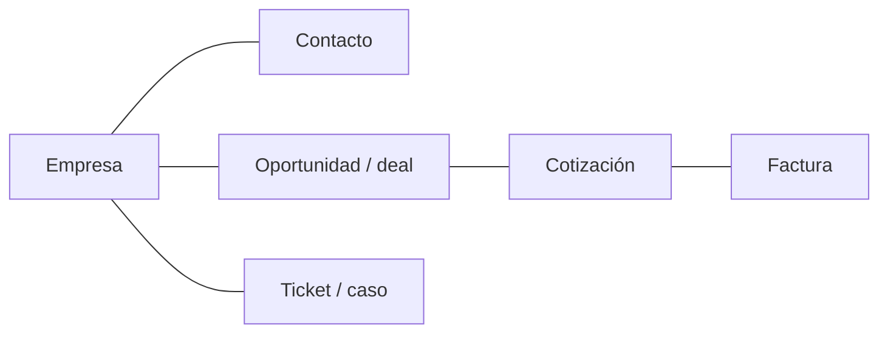
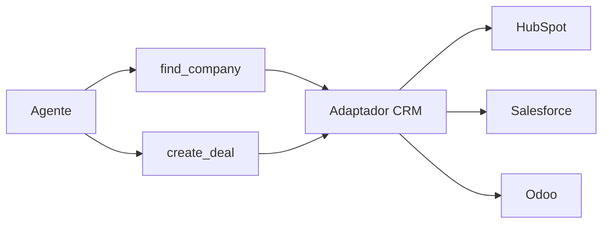

**Objetivo:** entender cómo se modelan los datos en un CRM y un ERP, y cómo un agente opera sobre HubSpot, Salesforce y Odoo a través de tools.

## Idea

Un **CRM** gestiona la relación comercial: empresas, contactos, oportunidades (deals), tickets, actividades. Un **ERP** gestiona la operación: facturas, pedidos, stock, contabilidad, y suele incluir un CRM. Para un agente, ambos son lo mismo: **objetos con campos y relaciones** detrás de una API REST o RPC.



### Vocabulario por sistema

| Concepto | HubSpot | Salesforce | Odoo |
|---|---|---|---|
| Empresa | Company | Account | `res.partner` (`is_company=True`) |
| Contacto | Contact | Contact | `res.partner` |
| Oportunidad | Deal | Opportunity | `crm.lead` (tipo opportunity) |
| Ticket | Ticket | Case | `helpdesk.ticket` |
| Consulta | Search API con filtros | SOQL (SQL propio) | dominios: `[("name", "=", "Acme")]` |
| Campos propios | Custom properties | Custom fields (`__c`) | Campos `x_` |
| API | REST v3 | REST + SOQL | JSON-2 (`/json/2/<model>/<method>`) |

### Cómo exponer un CRM a un agente

La tentación es darle al modelo una tool genérica `crm_request(method, path, body)`. Funciona mal y es peligroso. Lo que funciona:

- **Tools por tarea**, no por endpoint: `find_company(name)`, `create_deal(company_id, name, amount)`, `list_open_tickets(company_id)`.
- **Una capa de adaptador** por sistema: el agente ve siempre las mismas tools y el adaptador traduce a HubSpot, Salesforce u Odoo. Cambiar de CRM no cambia el prompt.
- **Resultados recortados**: solo los campos útiles, con ids para encadenar llamadas.
- **Lectura y escritura separadas**, con aprobación humana para escrituras sensibles (ver el módulo de Tool use).
- **Campos con valores válidos**: las etapas de un pipeline son distintas en cada cuenta. Una tool `list_deal_stages()` o el enum cargado en el esquema evita que el modelo invente una etapa.



## Cómo se implementa

Mismo ejemplo en los tres: buscar la empresa "Acme" por nombre y crear una oportunidad de 12.000 asociada a ella. Las dos funciones son las tools que ve el agente.

:::tabs
== HubSpot
API REST v3 con un token Bearer (OAuth o private app). Búsqueda con `filterGroups` y creación con asociaciones a otros objetos.

```python
import httpx

hubspot = httpx.Client(base_url="https://api.hubapi.com",
                       headers={"Authorization": f"Bearer {access_token}"})

def find_company(name: str) -> dict | None:
    response = hubspot.post("/crm/v3/objects/companies/search", json={
        "filterGroups": [{"filters": [{"propertyName": "name", "operator": "EQ", "value": name}]}],
        "properties": ["name", "domain"],
        "limit": 1,
    })
    response.raise_for_status()
    results = response.json()["results"]
    return {"id": results[0]["id"], **results[0]["properties"]} if results else None

def create_deal(company_id: str, name: str, amount: float) -> str:
    response = hubspot.post("/crm/v3/objects/deals", json={
        "properties": {"dealname": name, "amount": str(amount),
                       "pipeline": "default", "dealstage": "appointmentscheduled"},
        "associations": [{
            "to": {"id": company_id},
            "types": [{"associationCategory": "HUBSPOT_DEFINED", "associationTypeId": 5}],  # deal -> company
        }],
    })
    response.raise_for_status()
    return response.json()["id"]
```
== Salesforce
`simple-salesforce` envuelve la API REST: consultas con SOQL y un objeto por tipo de registro (`sf.Account`, `sf.Opportunity`).

```python
from simple_salesforce import Salesforce, format_soql

sf = Salesforce(instance_url=instance_url, session_id=access_token)

def find_company(name: str) -> dict | None:
    soql = format_soql("SELECT Id, Name, Website FROM Account WHERE Name = {} LIMIT 1", name)
    records = sf.query(soql)["records"]          # format_soql escapes the value
    return {"id": records[0]["Id"], "name": records[0]["Name"]} if records else None

def create_deal(company_id: str, name: str, amount: float) -> str:
    result = sf.Opportunity.create({
        "Name": name,
        "AccountId": company_id,
        "Amount": amount,
        "StageName": "Prospecting",
        "CloseDate": "2027-01-31",
    })
    return result["id"]
```

Para leer muchos registros, `sf.query_all_iter(soql)` recorre todas las páginas. Para cargas masivas existe la Bulk API (`sf.bulk2`).
== Odoo
API externa JSON-2: un POST a `/json/2/<modelo>/<método>` con argumentos con nombre y una API key como Bearer. Cualquier método de cualquier modelo (`search_read`, `create`, `write`) se llama igual.

```python
import httpx

odoo = httpx.Client(
    base_url="https://mycompany.odoo.com/json/2",
    headers={"Authorization": f"bearer {api_key}", "X-Odoo-Database": "mycompany"},
)

def call(model: str, method: str, **kwargs):
    response = odoo.post(f"/{model}/{method}", json=kwargs)
    response.raise_for_status()
    return response.json()

def find_company(name: str) -> dict | None:
    rows = call("res.partner", "search_read",
                domain=[["name", "=", name], ["is_company", "=", True]],
                fields=["id", "name", "website"], limit=1)
    return rows[0] if rows else None

def create_deal(company_id: int, name: str, amount: float) -> int:
    ids = call("crm.lead", "create", vals_list=[{
        "name": name,
        "partner_id": company_id,
        "expected_revenue": amount,
        "type": "opportunity",
    }])
    return ids[0]
```
:::

Las mismas funciones se registran como tools del agente (ver el módulo de Tool use) con descripciones que expliquen qué devuelven y cuándo usarlas.

## Errores comunes

- Una tool genérica que permite cualquier request a la API.
- Etapas, pipelines o valores de picklist hardcodeados que no existen en la cuenta del cliente.
- Concatenar strings para armar SOQL o filtros: inyección. Usá los helpers de escape o filtros estructurados.
- Devolver el objeto completo (cientos de propiedades) al modelo.
- Ignorar asociaciones: un deal creado sin empresa queda huérfano en el CRM.

## Preguntas de repaso

- **¿Cómo conectarías un agente a un CRM?** Con tools por tarea sobre una capa de adaptador, OAuth por usuario, resultados recortados, validación de campos y aprobación humana para escrituras sensibles.
- **¿Qué es SOQL?** El lenguaje de consultas de Salesforce, parecido a SQL, para leer registros y relaciones.
- **¿Qué ventaja tiene una capa de adaptador?** El agente ve siempre las mismas tools; cambiar o sumar un CRM solo cambia el adaptador.
- **¿Cómo evitás que el modelo invente valores de campos?** Enums en el esquema de la tool o una tool que lista los valores válidos de la cuenta.
