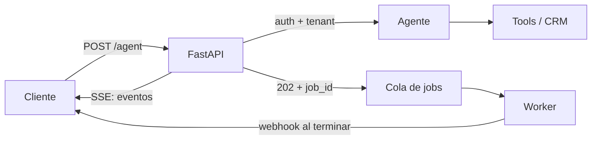

**Objetivo:** publicar un agente como servicio HTTP que otros sistemas (un frontend, un CRM, n8n) puedan llamar: request/response, streaming, autenticación y trabajos largos.

## Idea

Un agente es una función lenta y cara: puede tardar de segundos a minutos y llamar muchas tools. Exponerlo como API exige decidir **cómo espera el que llama**:

| Patrón | Cómo funciona | Cuándo |
|---|---|---|
| **Request/response** | POST, el agente corre, se devuelve el resultado | Tareas cortas (segundos), llamadas entre servicios |
| **Streaming (SSE)** | POST y la respuesta se va enviando como eventos mientras el agente trabaja | Chat con una persona mirando; mostrar progreso y tool calls |
| **Job asincrónico** | POST devuelve `202` con un `job_id`; se consulta el estado o se recibe un webhook al terminar | Tareas largas, procesos batch, sistemas que no soportan conexiones largas |



### Server-Sent Events

SSE es HTTP normal con `Content-Type: text/event-stream`: el servidor mantiene la respuesta abierta y escribe eventos (`event:` + `data:`). Es unidireccional (servidor → cliente), funciona a través de proxies y load balancers, y es lo que usan las APIs de los modelos para streamear. Para un agente conviene mandar **eventos tipados**: `text` (tokens de la respuesta), `tool_call`, `tool_result`, `done`, `error`.

### Autenticación y tenancy

Cada request trae una identidad (API key, JWT de tu IdP). De esa identidad salen el **tenant** y el **usuario**, y de ahí las credenciales de los sistemas externos (ver el capítulo de OAuth2). El cuerpo nunca trae tokens de terceros ni decide de qué cliente son los datos.

### Lo que una API de agente necesita además

- **Timeouts y límites**: tope de pasos y de tiempo por request.
- **Cancelación**: si el cliente corta el stream, detener el agente.
- **Conversaciones**: un `conversation_id` para cargar y guardar el historial (o el checkpoint del framework, ver el módulo de Orquestación de agentes).
- **Observabilidad**: un trace por request (ver el módulo de Evals y observabilidad).

## Cómo se implementa

Request/response con autenticación por Bearer y respuesta tipada:

```python
from fastapi import Depends, FastAPI, HTTPException
from fastapi.security import HTTPAuthorizationCredentials, HTTPBearer
from pydantic import BaseModel

app = FastAPI()
bearer = HTTPBearer()

class Caller(BaseModel):
    tenant_id: str
    user_id: str

def authenticate(creds: HTTPAuthorizationCredentials = Depends(bearer)) -> Caller:
    claims = verify_jwt(creds.credentials)           # your IdP; raises if invalid
    if claims is None:
        raise HTTPException(status_code=401, detail="invalid token")
    return Caller(tenant_id=claims["tenant"], user_id=claims["sub"])

class AskRequest(BaseModel):
    question: str
    conversation_id: str | None = None

class AskResponse(BaseModel):
    answer: str
    conversation_id: str
    tool_calls: int

@app.post("/agent/ask", response_model=AskResponse)
async def ask(body: AskRequest, caller: Caller = Depends(authenticate)) -> AskResponse:
    result = await support_agent.run(body.question, caller=caller,
                                     conversation_id=body.conversation_id)
    return AskResponse(answer=result.text, conversation_id=result.conversation_id,
                       tool_calls=len(result.tool_calls))
```

Streaming con SSE: la función es un generador y cada `yield` es un evento.

```python
from collections.abc import AsyncIterable
from fastapi.sse import EventSourceResponse, ServerSentEvent

@app.post("/agent/stream", response_class=EventSourceResponse)
async def stream(body: AskRequest, caller: Caller = Depends(authenticate)) -> AsyncIterable[ServerSentEvent]:
    async for event in support_agent.stream(body.question, caller=caller):
        # event: {"type": "text" | "tool_call" | "tool_result", ...}
        yield ServerSentEvent(data=event, event=event["type"])
    yield ServerSentEvent(data={"done": True}, event="done")
```

En el cable se ve así:

```text
event: tool_call
data: {"type": "tool_call", "name": "find_company", "input": {"name": "Acme"}}

event: text
data: {"type": "text", "text": "Acme tiene dos oportunidades abiertas"}

event: done
data: {"done": true}
```

Job asincrónico para tareas largas: se acepta, se encola y se consulta.

```python
from uuid import uuid4

class JobAccepted(BaseModel):
    job_id: str
    status_url: str

@app.post("/agent/jobs", status_code=202, response_model=JobAccepted)
async def create_job(body: AskRequest, caller: Caller = Depends(authenticate)) -> JobAccepted:
    job_id = str(uuid4())
    await jobs.save(job_id, status="queued", tenant_id=caller.tenant_id)
    await queue.send({"job_id": job_id, "question": body.question, "caller": caller.model_dump()})
    return JobAccepted(job_id=job_id, status_url=f"/agent/jobs/{job_id}")

@app.get("/agent/jobs/{job_id}")
async def get_job(job_id: str, caller: Caller = Depends(authenticate)) -> dict:
    job = await jobs.get(job_id, tenant_id=caller.tenant_id)   # scoped to the caller's tenant
    if job is None:
        raise HTTPException(status_code=404)
    return job
```

Un worker separado consume la cola, corre el agente, guarda el resultado y, si el cliente registró una URL, le manda un webhook firmado (ver el capítulo de Webhooks).

## Errores comunes

- Correr agentes largos dentro de un request síncrono: timeouts del load balancer y del cliente.
- Streaming de texto plano sin eventos tipados: el cliente no distingue tokens de tool calls ni sabe cuándo terminó.
- Tomar el tenant o el usuario del cuerpo del request en vez de la identidad autenticada.
- No limitar pasos ni tiempo por request.
- Consultar un job sin verificar que pertenece al tenant que pregunta.

## Preguntas de repaso

- **¿Cómo exponés un agente que tarda minutos?** Como job asincrónico: 202 con un id, cola y worker, y consulta de estado o webhook al terminar.
- **¿Por qué SSE para streaming?** Es HTTP estándar, unidireccional y compatible con proxies; alcanza para mandar tokens y eventos del agente al cliente.
- **¿De dónde salen las credenciales de los sistemas externos?** De la identidad autenticada (tenant y usuario), resueltas en el servidor; nunca del cuerpo del request ni del modelo.
- **¿Qué eventos mandarías en el stream de un agente?** Texto, tool call, tool result, error y fin, cada uno con su tipo.
