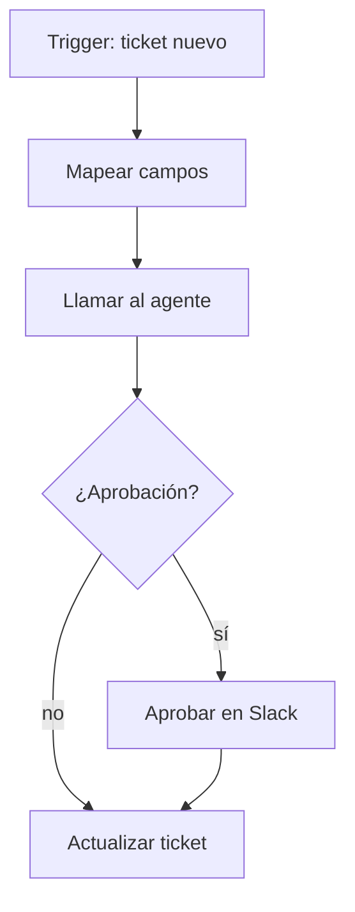

**Objetivo:** entender qué es n8n, cuándo conviene una plataforma de automatización y cómo se combina con un agente en las dos direcciones.

## Idea

**n8n** es una plataforma de automatización de flujos (*workflows*) con editor visual, open source y self-hostable. Un workflow es un grafo de **nodos**: un **trigger** que lo dispara (webhook, cron, evento de una app, formulario) y pasos que leen, transforman y escriben datos en cientos de servicios (Gmail, Slack, HubSpot, Salesforce, Postgres, Sheets) sin escribir la integración a mano.



### Cuándo n8n y cuándo código

| Situación | Mejor opción |
|---|---|
| Conectar sistemas con lógica simple (si pasa X, hacé Y en Z) | n8n |
| Equipos no técnicos que mantienen el flujo | n8n |
| Muchas integraciones distintas con poco volumen | n8n |
| Razonamiento, tools propias, estado complejo, evals | El agente en código |
| Alto volumen, latencia baja, lógica crítica versionada y testeada | Código |

El patrón habitual combina los dos: **n8n orquesta el proceso de negocio** (disparadores, aprobaciones, notificaciones, escritura en sistemas) y **el agente razona** en un paso concreto.

### Las dos direcciones

1. **n8n llama al agente**: un nodo *HTTP Request* hace POST a tu API de agente (ver el capítulo de FastAPI) y usa la respuesta en los pasos siguientes.
2. **El agente llama a n8n**: un workflow con trigger *Webhook* se expone como URL; para el agente es una tool más ("crear la factura en el ERP", "avisar al equipo de cuentas"). La lógica de integración vive en n8n y el agente no necesita conocer cada API.

n8n también tiene nodos de IA propios (un nodo *AI Agent* con modelos, memoria y tools, y nodos para vector stores), útiles para agentes simples armados visualmente. Para agentes con lógica propia, evals y control fino, el agente vive en código y n8n lo llama.

### Lo que hay que cuidar

- **Autenticación** en ambos sentidos: el webhook de n8n con header o firma, y n8n autenticado contra tu API.
- **Contratos**: el JSON que va y viene es una API; versionalo.
- **Errores**: n8n tiene workflows de error y reintentos por nodo; definí qué pasa si el agente falla o tarda.
- **Idempotencia**: si n8n reintenta un paso, tu agente no debe duplicar acciones (ver el capítulo de Webhooks).

## Cómo se implementa

**n8n → agente.** El nodo HTTP Request llama a la API del agente; del lado del agente es un endpoint normal. Lo que conviene es una respuesta estructurada, fácil de usar en los nodos siguientes:

```python
from typing import Literal
from pydantic import BaseModel

class TriageResult(BaseModel):
    category: Literal["billing", "bug", "feature_request", "other"]
    priority: Literal["low", "medium", "high"]
    needs_approval: bool
    draft_reply: str

@app.post("/agent/triage", response_model=TriageResult)
async def triage(ticket: TicketIn, caller: Caller = Depends(authenticate)) -> TriageResult:
    return await triage_agent.run(ticket, caller=caller)   # n8n branches on needs_approval
```

En n8n, el nodo siguiente usa los campos con expresiones como `{{ $json.needs_approval }}` y `{{ $json.draft_reply }}`.

**Agente → n8n.** Un workflow con trigger Webhook expuesto como tool del agente:

```python
import httpx

N8N_WEBHOOK = "https://n8n.example.com/webhook/create-invoice"

def create_invoice(customer_id: str, amount: float, description: str) -> str:
    """Create a draft invoice in the ERP and notify the accounts team.
    Returns the invoice number. Use only after the user confirmed the amount."""
    response = httpx.post(
        N8N_WEBHOOK,
        json={"customer_id": customer_id, "amount": amount, "description": description},
        headers={"X-Webhook-Token": N8N_TOKEN},
        timeout=30,
    )
    response.raise_for_status()
    return response.json()["invoice_number"]
```

El workflow de n8n recibe el JSON, crea la factura en el ERP, avisa por Slack y responde con *Respond to Webhook*. Si mañana cambia el ERP, se cambia el workflow y la tool del agente queda igual.

## Errores comunes

- Meter lógica de razonamiento compleja en decenas de nodos condicionales: eso es trabajo del agente.
- Webhooks de n8n sin autenticación.
- Respuestas del agente en texto libre que n8n tiene que parsear: devolvé JSON con esquema.
- Workflows sin manejo de errores: un fallo del agente deja el proceso a medias sin aviso.
- No versionar los workflows (exportarlos como JSON al repositorio).

## Preguntas de repaso

- **¿Qué es n8n?** Una plataforma open source de automatización de workflows con editor visual, triggers y nodos de integración para cientos de servicios.
- **¿Cómo combinás n8n con un agente?** n8n orquesta el proceso y llama al agente por HTTP para el paso que requiere razonamiento; el agente puede invocar workflows de n8n como tools vía webhook.
- **¿Cuándo usarías código en vez de n8n?** Para lógica compleja, alto volumen, baja latencia o cuando hace falta testear y evaluar el comportamiento.
- **¿Qué contrato usarías entre n8n y el agente?** JSON con esquema definido (por ejemplo, un modelo Pydantic), autenticación y respuestas idempotentes.
