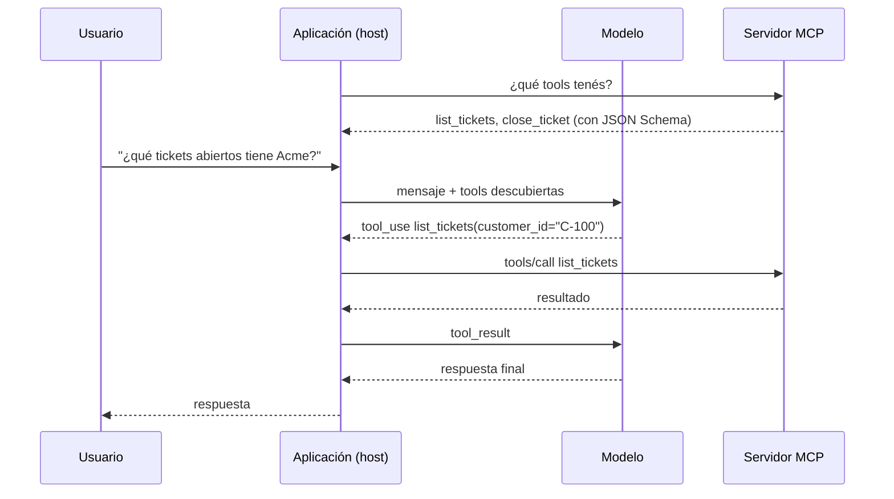

**Objetivo:** entender qué problema resuelve el Model Context Protocol, qué es y qué no es, y cómo se relaciona con tool use.

## Idea

### El problema: N aplicaciones × M integraciones

Cada aplicación con un LLM (un chat, un IDE, un agente propio) necesita conectarse a sistemas externos: GitHub, una base de datos, el CRM, el filesystem, Slack. Sin un estándar, cada aplicación escribe su propia integración con cada sistema, con su propio formato de tools, su propia autenticación y su propio manejo de errores.

<figure class="diagram">
<svg viewBox="0 0 760 250" role="img" aria-label="Sin MCP cada aplicación se integra con cada sistema; con MCP cada uno implementa el protocolo una vez">
<rect class="zone" x="6" y="6" width="364" height="238" rx="10"/>
<text x="188" y="36" text-anchor="middle" class="title">Sin MCP: N × M integraciones</text>
<line class="line" x1="126" y1="80.0" x2="246" y2="80.0"/>
<line class="line" x1="126" y1="80.0" x2="246" y2="140.0"/>
<line class="line" x1="126" y1="80.0" x2="246" y2="200.0"/>
<line class="line" x1="126" y1="140.0" x2="246" y2="80.0"/>
<line class="line" x1="126" y1="140.0" x2="246" y2="140.0"/>
<line class="line" x1="126" y1="140.0" x2="246" y2="200.0"/>
<line class="line" x1="126" y1="200.0" x2="246" y2="80.0"/>
<line class="line" x1="126" y1="200.0" x2="246" y2="140.0"/>
<line class="line" x1="126" y1="200.0" x2="246" y2="200.0"/>
<rect class="process" x="26" y="60" width="100" height="40" rx="8"/><text x="76.0" y="85.0" text-anchor="middle">Chat</text>
<rect class="process" x="26" y="120" width="100" height="40" rx="8"/><text x="76.0" y="145.0" text-anchor="middle">IDE</text>
<rect class="process" x="26" y="180" width="100" height="40" rx="8"/><text x="76.0" y="205.0" text-anchor="middle">Agente</text>
<rect class="store" x="246" y="60" width="104" height="40" rx="8"/><text x="298.0" y="85.0" text-anchor="middle">GitHub</text>
<rect class="store" x="246" y="120" width="104" height="40" rx="8"/><text x="298.0" y="145.0" text-anchor="middle">CRM</text>
<rect class="store" x="246" y="180" width="104" height="40" rx="8"/><text x="298.0" y="205.0" text-anchor="middle">Postgres</text>
<rect class="zone" x="396" y="6" width="364" height="238" rx="10"/>
<text x="578" y="36" text-anchor="middle" class="title">Con MCP: N + M</text>
<line class="line" x1="516" y1="80.0" x2="544" y2="140"/>
<line class="line" x1="612" y1="140" x2="636" y2="80.0"/>
<line class="line" x1="516" y1="140.0" x2="544" y2="140"/>
<line class="line" x1="612" y1="140" x2="636" y2="140.0"/>
<line class="line" x1="516" y1="200.0" x2="544" y2="140"/>
<line class="line" x1="612" y1="140" x2="636" y2="200.0"/>
<polygon class="input" points="544,140 558,120 598,120 612,140 598,160 558,160"/>
<text x="578" y="145" text-anchor="middle" class="title">MCP</text>
<rect class="process" x="416" y="60" width="100" height="40" rx="8"/><text x="466.0" y="85.0" text-anchor="middle">Chat</text>
<rect class="process" x="416" y="120" width="100" height="40" rx="8"/><text x="466.0" y="145.0" text-anchor="middle">IDE</text>
<rect class="process" x="416" y="180" width="100" height="40" rx="8"/><text x="466.0" y="205.0" text-anchor="middle">Agente</text>
<rect class="store" x="636" y="60" width="104" height="40" rx="8"/><text x="688.0" y="85.0" text-anchor="middle">GitHub</text>
<rect class="store" x="636" y="120" width="104" height="40" rx="8"/><text x="688.0" y="145.0" text-anchor="middle">CRM</text>
<rect class="store" x="636" y="180" width="104" height="40" rx="8"/><text x="688.0" y="205.0" text-anchor="middle">Postgres</text>
</svg>
<figcaption>Cada sistema se expone una vez como servidor y cada aplicación implementa el cliente una vez.</figcaption>
</figure>

**MCP** es un protocolo abierto que estandariza cómo una aplicación con un LLM descubre y usa capacidades externas. Un sistema se expone una vez como **servidor MCP**, y cualquier aplicación que hable MCP puede usarlo. Es la misma idea que el Language Server Protocol para editores: el soporte de un lenguaje se escribe una vez y funciona en cualquier editor.

### Qué expone un servidor

| Primitiva | Qué es | Quién decide usarla |
|---|---|---|
| **Tools** | Funciones que el modelo puede llamar: `list_tickets`, `create_issue` | El modelo |
| **Resources** | Datos que se pueden leer por URI: un archivo, un registro, un esquema de base de datos | La aplicación (o el usuario) |
| **Prompts** | Plantillas de prompt reutilizables que el usuario elige: "revisá este PR" | El usuario |

Y el servidor puede pedirle cosas al cliente: que le pregunte algo al usuario (**elicitation**), que haga una llamada al modelo del cliente (**sampling**), o qué carpetas o proyectos tiene abiertos (**roots**).

### Qué es y qué no es

- **No reemplaza a tool use.** El modelo sigue usando function calling (ver el módulo de Tool use). MCP define **de dónde salen** las tools y **cómo se ejecutan**: la aplicación las descubre en el servidor, se las pasa al modelo como tools comunes y, cuando el modelo pide una, reenvía la llamada al servidor.
- **No es un framework de agentes.** No decide el loop ni la orquestación. Es la capa de conexión entre el agente y el mundo exterior.
- **Es un protocolo de mensajes**, JSON-RPC 2.0, sobre un transporte: un proceso local (stdio) o HTTP.

### Por qué se adoptó

- **Reutilización**: un servidor de GitHub o de Postgres sirve para cualquier cliente MCP (Claude, ChatGPT, IDEs, agentes con LangGraph u OpenAI Agents SDK).
- **Separación de responsabilidades**: quien conoce el sistema escribe el servidor; quien construye el agente lo consume sin conocer la API interna.
- **Descubrimiento dinámico**: las tools se listan en tiempo de ejecución; el servidor puede agregar o quitar tools y avisar al cliente.
- **Ecosistema**: hay servidores para la mayoría de los sistemas populares, oficiales y de la comunidad.

### Cuándo conviene y cuándo no

| Situación | MCP | Tools definidas en el código del agente |
|---|---|---|
| La misma integración la usan varios agentes o aplicaciones | Sí | Duplicás código |
| Querés que la integración funcione en clientes de terceros (Claude, IDEs) | Sí | No es posible |
| Un único agente con tres funciones internas | Agrega una capa sin beneficio | Más simple |
| El equipo dueño del sistema quiere controlar cómo se expone | Sí, publica su servidor | Cada consumidor lo implementa a su manera |

## Errores comunes

- Pensar que MCP es una alternativa a function calling: es la forma de distribuir y ejecutar tools, que el modelo sigue usando con function calling.
- Envolver en MCP cada función interna de un único agente: más procesos, más latencia y más superficie de ataque sin reutilización.
- Exponer la API completa de un sistema como tools 1:1: el modelo recibe decenas de tools genéricas y elige peor. Un servidor bien diseñado expone tareas, no endpoints.
- Instalar servidores MCP de terceros sin revisarlos: un servidor local es código que corre en tu máquina con tus permisos.

## Preguntas de repaso

- **¿Qué problema resuelve MCP?** El de N aplicaciones × M integraciones: estandariza cómo se exponen y consumen tools, datos y prompts, para escribir cada integración una vez.
- **¿MCP reemplaza a function calling?** No. El modelo sigue usando function calling; MCP define cómo la aplicación descubre las tools en un servidor y le reenvía las llamadas.
- **¿Cuáles son las primitivas de un servidor?** Tools (las decide el modelo), resources (las decide la aplicación) y prompts (los elige el usuario).
- **¿Cuándo no usarías MCP?** Cuando las tools son internas de un solo agente y no se van a reutilizar: definirlas en el código es más simple.
