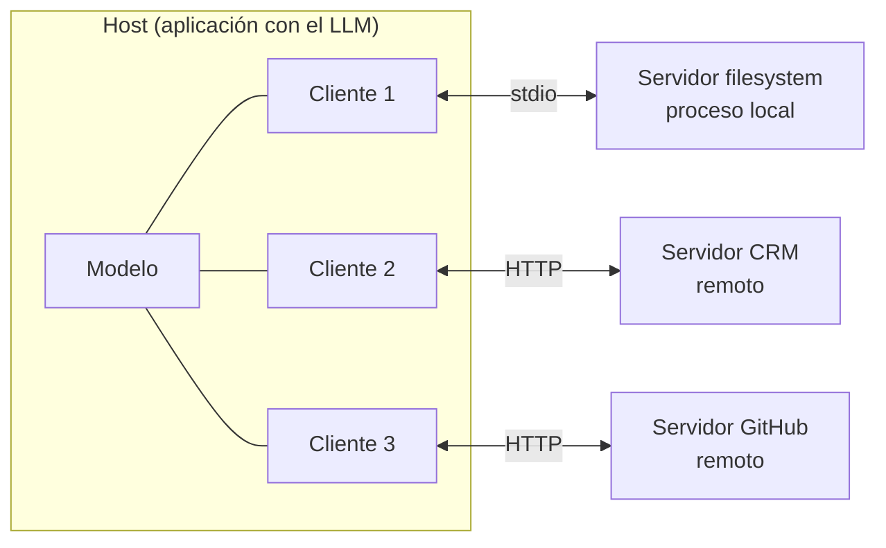
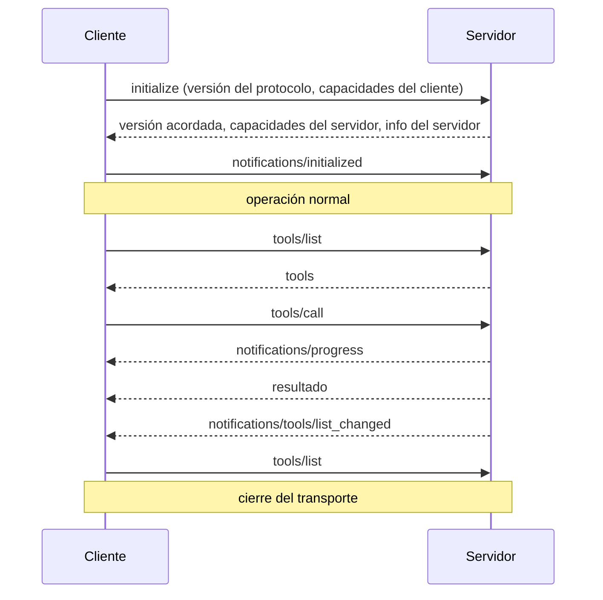

**Objetivo:** conocer los roles (host, cliente, servidor), las primitivas en los dos sentidos, los transportes y el ciclo de vida de una conexión.

## Idea

### Host, cliente y servidor

| Rol | Qué es | Ejemplos |
|---|---|---|
| **Host** | La aplicación que el usuario usa y que contiene al modelo. Decide qué servidores conectar, qué tools mostrar y qué permisos dar | Claude Desktop, un IDE, tu agente en LangGraph |
| **Cliente** | Un conector dentro del host. **Uno por servidor**, con su propia conexión | La sesión que abre el host contra el servidor de GitHub |
| **Servidor** | Un programa que expone tools, resources y prompts de un sistema | Servidor de GitHub, de Postgres, tu servidor del CRM |



El host es quien **agrega**: junta las tools de todos los servidores en una sola lista para el modelo, resuelve choques de nombres y aplica la política de qué se puede ejecutar sin preguntar.

### Primitivas en los dos sentidos

**Del servidor al cliente** (lo que el servidor ofrece):

| Primitiva | Métodos | Controlada por |
|---|---|---|
| Tools | `tools/list`, `tools/call` | El modelo decide llamarlas |
| Resources | `resources/list`, `resources/templates/list`, `resources/read`, `resources/subscribe` | La aplicación decide qué leer y cuándo pasarlo al contexto |
| Prompts | `prompts/list`, `prompts/get` | El usuario los elige (por ejemplo, como comandos `/`) |

**Del cliente al servidor** (lo que el servidor le puede pedir al host):

| Primitiva | Para qué |
|---|---|
| **Elicitation** | Pedirle datos o una confirmación al usuario en medio de una tool ("¿confirmás el reembolso de 49 USD?") |
| **Sampling** | Pedirle al host una llamada a **su** modelo. El servidor no necesita su propia API key ni elegir modelo |
| **Roots** | Saber qué carpetas o recursos tiene abiertos el usuario, para acotar lo que el servidor toca |

Además hay **notificaciones**: progreso de una operación larga, logs, y avisos de que cambió la lista de tools o un resource (`list_changed`, `resources/updated`).

### Tools: descripción y anotaciones

Una tool en MCP tiene lo mismo que en function calling (nombre, descripción, JSON Schema de entrada) y suma:

- **Output schema** y **structured content**: la tool puede declarar el esquema de su resultado y devolverlo como JSON, no solo como texto.
- **Anotaciones**: pistas para el host sobre el comportamiento: `readOnlyHint`, `destructiveHint`, `idempotentHint`, `openWorldHint`. El host las usa para decidir si pide confirmación. Son pistas declaradas por el servidor, no garantías.

### Mensajes: JSON-RPC 2.0

Todo intercambio es un request con `id` y su response, o una notificación sin respuesta. Una llamada a una tool:

```json
{"jsonrpc": "2.0", "id": 7, "method": "tools/call",
 "params": {"name": "list_tickets", "arguments": {"customer_id": "C-100"}}}
```

```json
{"jsonrpc": "2.0", "id": 7, "result": {
  "content": [{"type": "text", "text": "[{\"id\": \"T-1\", \"status\": \"open\"}]"}],
  "structuredContent": {"result": [{"id": "T-1", "status": "open"}]},
  "isError": false}}
```

Un error de la tool (argumento inválido, recurso inexistente) vuelve como resultado con `isError: true`, para que el modelo lo lea y se corrija. Los errores de protocolo (método inexistente, request mal formado) son errores JSON-RPC.

### Transportes

| Transporte | Cómo funciona | Cuándo |
|---|---|---|
| **stdio** | El host lanza el servidor como subproceso y se hablan por stdin/stdout | Servidores locales: filesystem, git, herramientas de desarrollo. Hereda los permisos del usuario |
| **Streamable HTTP** | Un endpoint HTTP (por ejemplo `/mcp`). El cliente hace POST con cada mensaje; el servidor responde con JSON o con un stream SSE cuando necesita mandar varios mensajes | Servidores remotos y compartidos, con autenticación OAuth |

### Ciclo de vida



En la negociación cada lado declara qué soporta (por ejemplo, el cliente declara si soporta elicitation; el servidor, si tiene tools, resources o prompts). Ninguno usa una capacidad que el otro no declaró.

## Errores comunes

- Confundir host y cliente: el host es la aplicación; hay un cliente por cada servidor conectado.
- Tratar las anotaciones (`readOnlyHint`, `destructiveHint`) como garantía de seguridad: las declara el servidor; el host decide igual qué confirmar.
- Devolver errores de la tool como errores de protocolo: el modelo no los ve y no puede corregirse.
- Usar resources como si fueran tools: los resources los elige la aplicación, no el modelo.

## Preguntas de repaso

- **¿Qué diferencia hay entre host, cliente y servidor?** El host es la aplicación con el modelo; el cliente es la conexión del host con un servidor (una por servidor); el servidor expone capacidades de un sistema.
- **¿Tools, resources o prompts?** Tools para acciones que decide el modelo; resources para datos que la aplicación lee y pone en contexto; prompts para plantillas que elige el usuario.
- **¿Qué es sampling?** Que el servidor le pida al host una llamada a su modelo, sin tener credenciales ni modelo propios.
- **¿stdio o Streamable HTTP?** stdio para servidores locales lanzados como subproceso; Streamable HTTP para servidores remotos, compartidos y con autenticación.
