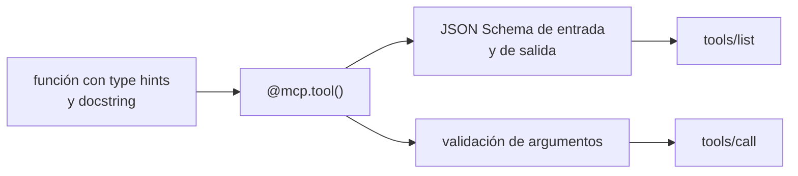

**Objetivo:** construir un servidor MCP con el SDK oficial de Python: tools, resources, prompts, salida estructurada, progreso, confirmación del usuario y transportes.

## Idea

Un servidor MCP es un conjunto de handlers registrados por nombre. El SDK se encarga del protocolo: genera el JSON Schema desde los type hints, valida argumentos, arma las respuestas, negocia capacidades y habla el transporte. Lo que escribís son funciones Python comunes.



Decisiones de diseño que más importan:

- **Tools orientadas a tareas**, no a endpoints: `close_ticket(ticket_id)` y no `update_entity(type, id, fields)`.
- **Descripciones como prompts**: qué hace, cuándo usarla, qué devuelve. Es lo que lee el modelo.
- **Resultados chicos y estructurados**: solo los campos útiles, con un modelo Pydantic como tipo de retorno.
- **Errores accionables**: un mensaje que le diga al modelo cómo corregirse.
- **Resources para datos de referencia** que la aplicación puede poner en contexto sin que el modelo tenga que pedirlos.

## Cómo se implementa

El ejemplo es un servidor de un CRM de soporte con dos tools, un resource y un prompt.

```python
import json
from pydantic import BaseModel
from mcp.server import MCPServer
from mcp.server.mcpserver.exceptions import ToolError
from mcp.types import ToolAnnotations

mcp = MCPServer("crm", instructions="Read and update customer support tickets.")

class Ticket(BaseModel):
    id: str
    customer_id: str
    subject: str
    status: str

@mcp.tool(annotations=ToolAnnotations(read_only_hint=True))
def list_tickets(customer_id: str, status: str = "open") -> list[Ticket]:
    """List the support tickets of a customer, filtered by status ("open" or "closed")."""
    return [Ticket(**t) for t in db.tickets(customer_id, status)]

@mcp.tool(annotations=ToolAnnotations(destructive_hint=False, idempotent_hint=True))
def close_ticket(ticket_id: str) -> Ticket:
    """Close a ticket. Returns the updated ticket."""
    if not db.exists(ticket_id):
        raise ToolError(f"Unknown ticket_id '{ticket_id}'. Use list_tickets to find valid ids.")
    return Ticket(**db.close(ticket_id))

@mcp.resource("crm://tickets/{ticket_id}", mime_type="application/json")
def ticket(ticket_id: str) -> str:
    """A ticket with its full history, as JSON."""
    return json.dumps(db.ticket_with_history(ticket_id))

@mcp.prompt()
def triage(ticket_id: str) -> str:
    """Triage a ticket and propose next steps."""
    return f"Read crm://tickets/{ticket_id}, classify the problem and propose the next steps."

if __name__ == "__main__":
    mcp.run()                              # stdio
    # mcp.run(transport="streamable-http") # HTTP endpoint at /mcp
```

Qué produce cada decorador:

| Código | Lo que ve el cliente |
|---|---|
| `customer_id: str, status: str = "open"` | `inputSchema` con `customer_id` requerido y `status` opcional |
| `-> list[Ticket]` | `outputSchema` y el resultado en `structuredContent` |
| Docstring | `description` de la tool |
| `raise ToolError(...)` | Resultado con `isError: true` y el mensaje, que el modelo puede leer |
| `"crm://tickets/{ticket_id}"` | Un resource template: el cliente lee `crm://tickets/T-1` |

### Contexto: logs y progreso

Una tool puede recibir el `Context` de la request para mandar logs y progreso al cliente mientras trabaja:

```python
from mcp.server.mcpserver import Context

@mcp.tool()
async def export_tickets(customer_id: str, ctx: Context) -> str:
    """Export every ticket of a customer to the reporting system."""
    tickets = db.all_tickets(customer_id)
    for i, t in enumerate(tickets, 1):
        await reporting.push(t)
        await ctx.report_progress(i, len(tickets), f"exported {t['id']}")
    await ctx.info(f"exported {len(tickets)} tickets for {customer_id}")
    return f"Exported {len(tickets)} tickets."
```

### Confirmación del usuario (elicitation)

Para acciones irreversibles, la tool puede pedirle al usuario una confirmación a través del host. Un parámetro anotado con `Resolve` no lo completa el modelo: lo resuelve el servidor antes de ejecutar la tool, y `Elicit` le pide el dato al usuario con un esquema.

```python
from typing import Annotated
from mcp.server.mcpserver import Elicit, Resolve

class Confirm(BaseModel):
    confirm: bool

def ask_confirmation(customer_id: str, amount_usd: float) -> Elicit[Confirm]:
    return Elicit(f"Refund {amount_usd} USD to {customer_id}?", Confirm)

@mcp.tool()
def issue_refund(
    customer_id: str,
    amount_usd: float,
    answer: Annotated[Confirm, Resolve(ask_confirmation)],
) -> str:
    """Refund money to a customer. Irreversible: asks the user first."""
    if not answer.confirm:
        return "Refund cancelled by the user."
    payments.refund(customer_id, amount_usd)
    return f"Refunded {amount_usd} USD to {customer_id}."
```

El modelo solo ve `customer_id` y `amount_usd` en el esquema de la tool. La confirmación pasa por la interfaz del host, fuera del control del modelo.

### Transportes

```python
mcp.run()                              # stdio: the host launches this script as a subprocess
mcp.run(transport="streamable-http")   # HTTP: a long-running service with an /mcp endpoint
```

El mismo servidor sirve para los dos. stdio para uso local (el host lo lanza con un comando); Streamable HTTP para desplegarlo como servicio compartido, detrás de autenticación (ver el capítulo de seguridad).

> [!TIP]
> El SDK incluye un cliente en memoria: `Client(mcp)` conecta directo con el objeto servidor, sin proceso ni red. Es la forma natural de testear un servidor (ver el capítulo del cliente).

## Errores comunes

- Docstrings vacíos o genéricos: el modelo no sabe cuándo usar la tool.
- Devolver la respuesta cruda de la API interna: cientos de campos que llenan el contexto.
- Tools genéricas tipo `run_query(sql)` cuando alcanzaban tools específicas: más poder del necesario y más riesgo.
- Pedir confirmación al modelo en la descripción ("preguntá antes de reembolsar") en vez de usar elicitation o la política del host.
- Escribir a stdout en un servidor stdio: stdout es el canal del protocolo. Los logs van por el `Context` o a stderr.

## Preguntas de repaso

- **¿Cómo se genera el esquema de una tool en el SDK de Python?** A partir de los type hints de la función (entrada y salida) y del docstring como descripción.
- **¿Qué es structured content?** El resultado de la tool como JSON que valida contra un output schema declarado, además del contenido en texto.
- **¿Cómo pedís confirmación antes de una acción irreversible?** Con elicitation: el servidor le pide al host que pregunte al usuario con un esquema, y sigue según la respuesta.
- **¿Cómo reporta errores una tool?** Como resultado con `isError: true` y un mensaje accionable, para que el modelo pueda corregirse.
