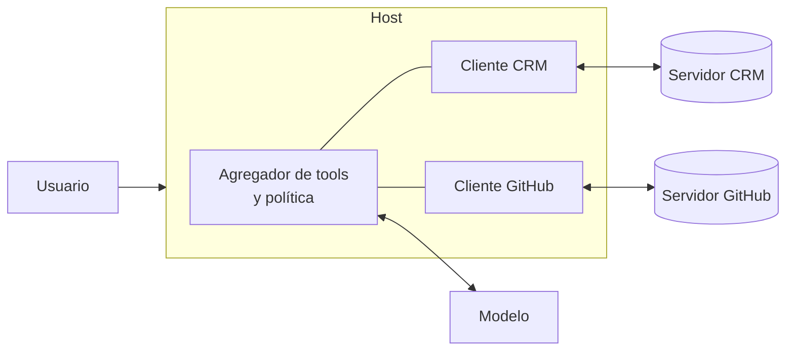

**Objetivo:** conectarse a un servidor, descubrir y usar sus capacidades, y responder a los pedidos que el servidor le hace al host.

## Idea

El cliente es la mitad del protocolo que vive en el host. Por cada servidor:

1. **Conecta** por el transporte que corresponda: lanza un subproceso (stdio) o abre una conexión HTTP.
2. **Negocia** versión y capacidades.
3. **Descubre**: lista tools, resources y prompts. Vuelve a listar cuando el servidor avisa que algo cambió.
4. **Opera**: llama tools, lee resources, pide prompts.
5. **Responde** a lo que pide el servidor: confirmaciones del usuario (elicitation), llamadas al modelo (sampling), roots.

Un host con varios servidores tiene que resolver además:

| Problema | Qué hace el host |
|---|---|
| Dos servidores con una tool `search` | Prefija los nombres (`github_search`, `crm_search`) o deja elegir al usuario |
| Demasiadas tools en total | Muestra al modelo solo las de los servidores relevantes, o las carga bajo demanda |
| Tools que modifican datos | Pide confirmación según la política, usando las anotaciones como pista |
| Un servidor que no responde | Timeouts por request y reconexión; el resto de los servidores sigue funcionando |



## Cómo se implementa

El SDK de Python tiene un `Client` que acepta cualquier destino: una URL (Streamable HTTP), los parámetros para lanzar un proceso (stdio) o el objeto servidor directamente (en memoria).

```python
import sys
from mcp import Client, StdioServerParameters

local = StdioServerParameters(command=sys.executable, args=["crm_server.py"])

async with Client(local) as client:                     # or Client("https://crm.example.com/mcp")
    tools = await client.list_tools()
    for tool in tools.tools:
        print(tool.name, tool.annotations, tool.input_schema)

    result = await client.call_tool("list_tickets", {"customer_id": "C-100"})
    if result.is_error:
        print("tool error:", result.content[0].text)
    else:
        print(result.structured_content)                # {'result': [{'id': 'T-1', ...}]}

    resource = await client.read_resource("crm://tickets/T-1")
    print(resource.contents[0].text)

    prompt = await client.get_prompt("triage", {"ticket_id": "T-1"})
    print(prompt.messages[0].content.text)
```

### Responder a elicitation

Cuando una tool del servidor pide confirmación, el cliente recibe el pedido en un callback. El host muestra la pregunta al usuario y devuelve `accept`, `decline` o `cancel` con los datos del esquema.

```python
from mcp import types

async def on_elicit(context, params) -> types.ElicitResult:
    answer = await ui.confirm(params.message)            # your UI: a dialog, a Slack button...
    if answer is None:
        return types.ElicitResult(action="cancel")
    return types.ElicitResult(action="accept", content={"confirm": answer})

async with Client(local, elicitation_callback=on_elicit) as client:
    await client.call_tool("issue_refund", {"customer_id": "C-100", "amount_usd": 49})
```

Sampling y roots funcionan igual, con `sampling_callback` y `list_roots_callback`: el host decide si atiende el pedido y con qué modelo.

### Testear un servidor

Pasar el objeto servidor al `Client` lo conecta en memoria: mismo protocolo, sin subproceso ni red. Es la base de los tests de un servidor.

```python
from crm_server import mcp

async def test_list_tickets_returns_open_tickets():
    async with Client(mcp) as client:
        result = await client.call_tool("list_tickets", {"customer_id": "C-100"})
        assert not result.is_error
        assert all(t["status"] == "open" for t in result.structured_content["result"])

async def test_unknown_ticket_is_a_tool_error():
    async with Client(mcp) as client:
        result = await client.call_tool("close_ticket", {"ticket_id": "T-999"})
        assert result.is_error
```

## Errores comunes

- Listar las tools una sola vez al conectar e ignorar las notificaciones de cambio.
- Pasarle al modelo todas las tools de todos los servidores sin filtrar ni prefijar.
- Responder automáticamente `accept` a elicitation: el pedido existe para que decida una persona.
- Ignorar `is_error` y tratar el texto de error como un resultado válido.
- No poner timeouts por request: un servidor colgado bloquea al agente entero.

## Preguntas de repaso

- **¿Qué hace un cliente MCP al conectarse?** Negocia versión y capacidades, lista tools, resources y prompts, y queda atento a notificaciones de cambio.
- **¿Cómo maneja un host varios servidores?** Un cliente por servidor, un agregador que junta y prefija tools, y una política de qué se ejecuta sin confirmación.
- **¿Cómo responde un cliente a una elicitation?** Con un callback que muestra el pedido al usuario y devuelve accept, decline o cancel con los datos.
- **¿Cómo testeás un servidor MCP?** Con un cliente conectado en memoria al objeto servidor, llamando tools y verificando resultados y errores.
