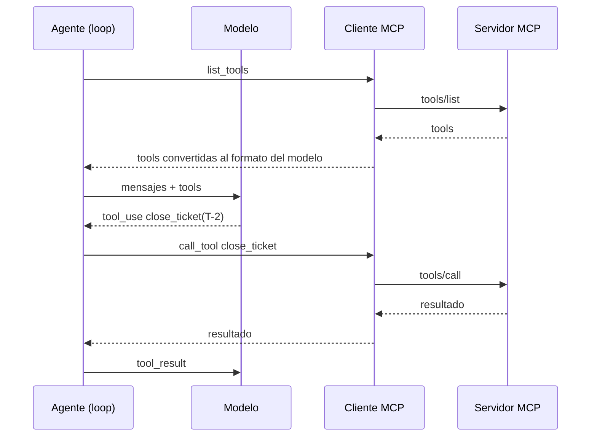

**Objetivo:** usar las tools de servidores MCP dentro de un agente, con el SDK del proveedor o con un framework.

## Idea

Conectar un servidor MCP a un agente son siempre los mismos pasos:

1. Abrir un cliente contra el servidor.
2. Listar sus tools y **convertirlas** al formato de tools del modelo o del framework (nombre, descripción, JSON Schema).
3. Correr el loop de agente de siempre (ver el módulo de Tool use).
4. Cuando el modelo pide una de esas tools, **reenviar** la llamada al servidor con `tools/call` y devolver el resultado como `tool_result`.



Hay dos lugares donde puede vivir el cliente:

| Dónde | Cómo | Cuándo |
|---|---|---|
| **En tu proceso** | Tu código abre el cliente (stdio o HTTP) y convierte las tools | Servidores locales, control total, mezclar con tools propias |
| **En el proveedor del modelo** | Le pasás la URL del servidor remoto a la API; el proveedor se conecta y ejecuta las tools | Servidores remotos públicos o accesibles desde internet, menos código |

Los frameworks resuelven la conversión y la conexión a varios servidores a la vez; el loop sigue siendo el del framework.

## Cómo se implementa

Mismo caso en todos los tabs: el servidor del CRM (`crm_server.py`, con `list_tickets` y `close_ticket`) y la tarea "Acme dice que el export a CSV ya funciona: cerrá ese ticket y decime qué les queda abierto".

:::tabs
== Anthropic
**Cliente en tu proceso**: el SDK convierte cada tool MCP en una tool del tool runner, que corre el loop y reenvía las llamadas al servidor.

```python
import sys
import anthropic
from anthropic.lib.tools.mcp import async_mcp_tool
from mcp import Client, StdioServerParameters

claude = anthropic.AsyncAnthropic()
crm = StdioServerParameters(command=sys.executable, args=["crm_server.py"])

async with Client(crm) as mcp_client:
    listed = await mcp_client.list_tools()
    runner = claude.beta.messages.tool_runner(
        model="claude-opus-5-5",
        max_tokens=8192,
        tools=[async_mcp_tool(t, mcp_client.session) for t in listed.tools],
        messages=[{"role": "user", "content": task}],
    )
    async for message in runner:
        ...
```

**Cliente en la API (MCP connector)**: para un servidor remoto, la API se conecta sola. `mcp_toolset` define qué tools del servidor se habilitan.

```python
response = claude.beta.messages.create(
    model="claude-opus-5-5",
    max_tokens=8192,
    betas=["mcp-client-2025-11-20"],
    mcp_servers=[{"type": "url", "name": "crm", "url": "https://crm.example.com/mcp",
                  "authorization_token": crm_token}],
    tools=[{"type": "mcp_toolset", "mcp_server_name": "crm",
            "default_config": {"enabled": False},
            "configs": {"list_tickets": {"enabled": True}, "close_ticket": {"enabled": True}}}],
    messages=[{"role": "user", "content": task}],
)
# the response contains mcp_tool_use and mcp_tool_result blocks, executed by the API
```
== LangChain
`MultiServerMCPClient` se conecta a varios servidores y devuelve sus tools como tools de LangChain, listas para `create_agent` (que corre sobre LangGraph) o para un `ToolNode` propio.

```python
import sys
from langchain.agents import create_agent
from langchain_anthropic import ChatAnthropic
from langchain_mcp_adapters.client import MultiServerMCPClient

client = MultiServerMCPClient({
    "crm": {"transport": "stdio", "command": sys.executable, "args": ["crm_server.py"]},
    "github": {"transport": "streamable_http", "url": "https://github-mcp.example.com/mcp",
               "headers": {"Authorization": f"Bearer {github_token}"}},
})
tools = await client.get_tools()                      # tools from every server

agent = create_agent(
    ChatAnthropic(model="claude-opus-5-5", max_tokens=8192),
    tools=tools,
    system_prompt="You are a support operations agent.",
)
result = await agent.ainvoke({"messages": [{"role": "user", "content": task}]})
```

`client.get_tools(server_name="crm")` trae las de un solo servidor; `tool_name_prefix=True` en el cliente prefija los nombres con el del servidor para evitar choques.
== OpenAI
En el OpenAI Agents SDK los servidores MCP son parte del agente: se pasan en `mcp_servers` y el SDK lista sus tools en cada corrida.

```python
import sys
from agents import Agent, Runner
from agents.mcp import MCPServerStdio, MCPServerStreamableHttp

async with (
    MCPServerStdio(name="crm", params={"command": sys.executable, "args": ["crm_server.py"]}) as crm,
    MCPServerStreamableHttp(name="github", params={"url": "https://github-mcp.example.com/mcp",
                                                   "headers": {"Authorization": f"Bearer {github_token}"}}) as github,
):
    agent = Agent(
        name="Support ops",
        instructions="You are a support operations agent.",
        mcp_servers=[crm, github],
    )
    result = await Runner.run(agent, task)
    print(result.final_output)
```

`tool_filter` limita qué tools de cada servidor ve el agente, y `require_approval` define cuáles necesitan aprobación humana.
:::

## Errores comunes

- Conectar todos los servidores disponibles "por las dudas": cada tool extra compite por la atención del modelo y suma tokens en cada llamada.
- Habilitar todas las tools de un servidor remoto cuando el agente necesita dos: usá allowlists por tool.
- Abrir y cerrar la conexión stdio en cada llamada: el costo de lanzar el proceso se paga una vez por sesión, no por tool.
- Mezclar tools propias y de MCP con el mismo nombre.

## Preguntas de repaso

- **¿Cómo usa un agente las tools de un servidor MCP?** Las lista con un cliente, las convierte al formato del modelo, y reenvía al servidor cada tool call que el modelo hace.
- **¿Cliente en tu proceso o en la API del proveedor?** En tu proceso para servidores locales y control total; en la API para servidores remotos accesibles desde internet con menos código.
- **¿Cómo limitás qué tools de un servidor usa el agente?** Con allowlists o filtros por tool en el cliente o en la configuración del conector.
