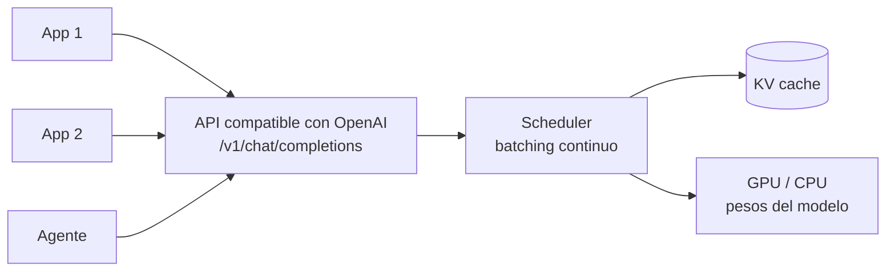

**Objetivo:** entender qué hace un servidor de inferencia y usar los dos más comunes, Ollama y vLLM, desde código con la misma API que un proveedor comercial.

## Idea

Cargar un modelo en un script sirve para probar. Para una aplicación hace falta un **servidor de inferencia**: un proceso que mantiene el modelo en memoria, recibe requests por HTTP y las atiende de forma concurrente.



### Conceptos que importan

| Concepto | Qué es |
|---|---|
| **API compatible con OpenAI** | El servidor expone `/v1/chat/completions` con el mismo formato que OpenAI. Cualquier SDK o framework que hable OpenAI funciona cambiando `base_url` |
| **KV cache** | Guarda los cálculos de los tokens ya procesados de cada conversación para no recalcularlos al generar el siguiente. Ocupa memoria proporcional a contexto × requests concurrentes |
| **Batching continuo** | En vez de esperar a juntar un lote, el servidor mete y saca requests del lote en cada paso de generación. Multiplica el throughput |
| **PagedAttention** | Técnica de vLLM que administra el KV cache en bloques como memoria paginada; desperdicia menos y permite más requests simultáneas |
| **Throughput vs latencia** | Más requests en paralelo sube los tokens por segundo totales pero puede subir la latencia de cada una |

### Ollama y vLLM

| | Ollama | vLLM |
|---|---|---|
| Para qué | Desarrollo local, laptops, un usuario o pocos | Producción en GPU, muchos usuarios concurrentes |
| Modelos | Catálogo propio en formato GGUF (cuantizados) | Modelos de Hugging Face (BF16, FP8, AWQ, GPTQ) |
| Hardware | CPU, Apple Silicon, GPUs de consumo | GPUs NVIDIA/AMD de servidor |
| Fuerte en | Simplicidad: un comando y anda | Throughput: batching continuo, PagedAttention, multi-GPU |
| API | Propia + compatible con OpenAI | Compatible con OpenAI |

Patrón habitual: Ollama en la máquina del desarrollador, vLLM en el servidor, y el mismo código cliente para los dos.

## Cómo se implementa

Mismo ejemplo en los dos tabs: levantar Qwen3 8B y pedirle una clasificación de un ticket, primero con el cliente propio y después con el SDK de OpenAI.

:::tabs
== Ollama
El servidor corre en segundo plano y descarga modelos por nombre del catálogo.

```sh
ollama pull qwen3:8b
ollama run qwen3:8b "Hola"        # quick interactive test
```

Cliente de Python:

```python
import ollama

response = ollama.chat(
    model="qwen3:8b",
    messages=[
        {"role": "system", "content": "Classify the ticket as billing, bug or other. Reply with one word."},
        {"role": "user", "content": "I was charged twice in October."},
    ],
)
print(response.message.content)
```

Salida estructurada con un JSON Schema:

```python
from pydantic import BaseModel

class Ticket(BaseModel):
    category: str
    urgent: bool

response = ollama.chat(model="qwen3:8b", messages=messages, format=Ticket.model_json_schema())
ticket = Ticket.model_validate_json(response.message.content)
```

Con el SDK de OpenAI, apuntando al endpoint compatible:

```python
from openai import OpenAI

client = OpenAI(base_url="http://localhost:11434/v1", api_key="ollama")
completion = client.chat.completions.create(model="qwen3:8b", messages=messages)
print(completion.choices[0].message.content)
```
== vLLM
Un comando levanta el servidor compatible con OpenAI con un modelo de Hugging Face.

```sh
vllm serve Qwen/Qwen3-8B --max-model-len 16384
```

Cliente: el SDK de OpenAI con otro `base_url`. Todo lo que funciona con OpenAI funciona igual.

```python
from openai import OpenAI

client = OpenAI(base_url="http://localhost:8000/v1", api_key="local")
completion = client.chat.completions.create(
    model="Qwen/Qwen3-8B",
    messages=[
        {"role": "system", "content": "Classify the ticket as billing, bug or other. Reply with one word."},
        {"role": "user", "content": "I was charged twice in October."},
    ],
    max_tokens=16,
)
print(completion.choices[0].message.content)
```

Inferencia offline por lotes (sin servidor), útil para procesar miles de documentos:

```python
from vllm import LLM, SamplingParams

llm = LLM(model="Qwen/Qwen3-8B")
params = SamplingParams(temperature=0.0, max_tokens=16)
conversations = [[{"role": "user", "content": f"Classify: {t}"}] for t in tickets]
outputs = llm.chat(conversations, params)
labels = [o.outputs[0].text for o in outputs]
```
:::

> [!TIP]
> Como los dos hablan la API de OpenAI, cambiar entre un modelo local y uno comercial es cambiar `base_url` y `model`. Los frameworks del módulo de Orquestación de agentes y las tools del módulo de Tool use funcionan igual sobre un modelo propio, siempre que el modelo soporte tool calling.

## Errores comunes

- Usar Ollama para producción con muchos usuarios: está pensado para pocos clientes, no para alto throughput.
- No limitar el largo de contexto: el KV cache crece y el servidor admite menos requests simultáneas.
- Medir latencia con una sola request y extrapolar: con carga real el comportamiento cambia.
- Asumir que cualquier modelo abierto hace tool calling o salida estructurada igual de bien que uno comercial: hay que medirlo.

## Preguntas de repaso

- **¿Qué hace un servidor de inferencia como vLLM?** Mantiene el modelo cargado, atiende requests concurrentes por HTTP con una API compatible con OpenAI y maximiza el uso de la GPU con batching continuo y manejo eficiente del KV cache.
- **¿Qué es el KV cache?** La memoria con los cálculos de atención de los tokens ya procesados; evita recalcular el contexto en cada token nuevo.
- **¿Ollama o vLLM?** Ollama para local y pocos usuarios; vLLM para servir en GPU con muchos usuarios concurrentes.
- **¿Por qué importa que la API sea compatible con OpenAI?** Porque el mismo código cliente, SDK o framework sirve para modelos locales y comerciales.
