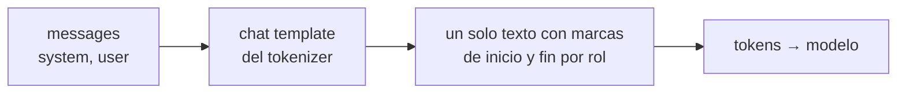

**Objetivo:** moverse en el Hub de Hugging Face y cargar, tokenizar y ejecutar un modelo con transformers, entendiendo qué son los chat templates.

## Idea

Hugging Face es el lugar donde se publican casi todos los modelos abiertos, y `transformers` es la librería estándar para usarlos desde Python.

| Pieza | Qué es |
|---|---|
| **Hub** | Repositorios git de modelos, datasets y demos. Cada modelo tiene pesos, configuración, tokenizer y una **model card** con uso, licencia y evaluaciones |
| **transformers** | Carga cualquier arquitectura con la misma interfaz (`Auto*`), tokeniza, genera y entrena |
| **Tokenizer** | Convierte texto en ids de tokens y de vuelta. Cada modelo trae el suyo |
| **Chat template** | La plantilla que convierte una lista de mensajes con roles en el texto exacto que el modelo vio en su entrenamiento |
| **safetensors** | Formato de archivo de pesos seguro y rápido de cargar |

### Chat templates

Un modelo instruct no recibe "mensajes": recibe **un solo texto** con marcas especiales que separan roles. Cada familia usa marcas distintas. El chat template, que viene con el tokenizer, hace esa conversión. Si se arma el texto a mano con el formato equivocado, el modelo responde mucho peor.



Los servidores (Ollama, vLLM) y las APIs aplican el template por vos. Con transformers lo aplicás explícitamente con `apply_chat_template`.

## Cómo se ve en código

**Explorar el Hub** desde Python:

```python
from huggingface_hub import HfApi, snapshot_download

api = HfApi()
for model in api.list_models(search="Qwen3", sort="downloads", limit=5):
    print(model.id, model.downloads)

local_dir = snapshot_download("Qwen/Qwen3-0.6B")   # downloads weights, config and tokenizer
```

**Pipeline**: la forma más corta de generar.

```python
from transformers import pipeline

generator = pipeline("text-generation", model="Qwen/Qwen3-0.6B", device_map="auto")
messages = [{"role": "user", "content": "Explain what a token is in one sentence."}]
result = generator(messages, max_new_tokens=60)
print(result[0]["generated_text"][-1]["content"])
```

**Paso a paso**: tokenizer, chat template, generación y decodificación.

```python
from transformers import AutoModelForCausalLM, AutoTokenizer

model_id = "Qwen/Qwen3-0.6B"
tokenizer = AutoTokenizer.from_pretrained(model_id)
model = AutoModelForCausalLM.from_pretrained(model_id, dtype="auto", device_map="auto")

messages = [
    {"role": "system", "content": "You are a concise assistant."},
    {"role": "user", "content": "What is a context window?"},
]
inputs = tokenizer.apply_chat_template(
    messages, add_generation_prompt=True, return_tensors="pt", return_dict=True
).to(model.device)

output = model.generate(**inputs, max_new_tokens=80)
new_tokens = output[0][inputs["input_ids"].shape[-1]:]
print(tokenizer.decode(new_tokens, skip_special_tokens=True))
```

`add_generation_prompt=True` agrega la marca de "ahora habla el assistant" al final, para que el modelo empiece la respuesta.

**Ver el texto que realmente recibe el modelo**:

```python
print(tokenizer.apply_chat_template(messages, add_generation_prompt=True, tokenize=False))
print(tokenizer.tokenize("La tokenización no es obvia"))
```

## Errores comunes

- Armar el prompt a mano en vez de usar el chat template del modelo.
- Olvidar `add_generation_prompt=True`: el modelo continúa el mensaje del usuario en vez de responder.
- Decodificar toda la salida de `generate` (incluye el prompt) en vez de solo los tokens nuevos.
- Usar el tokenizer de un modelo con otro modelo.
- No leer la model card: ahí están el template, la licencia y el uso recomendado.

## Preguntas de repaso

- **¿Qué es un chat template?** La plantilla que convierte mensajes con roles en el texto con marcas especiales que el modelo espera; cada familia tiene la suya.
- **¿Para qué sirven las clases `Auto*` de transformers?** Para cargar cualquier arquitectura con la misma interfaz a partir del nombre del repositorio en el Hub.
- **¿Qué contiene un repositorio de modelo en el Hub?** Pesos (safetensors), configuración, tokenizer con su chat template y la model card.
