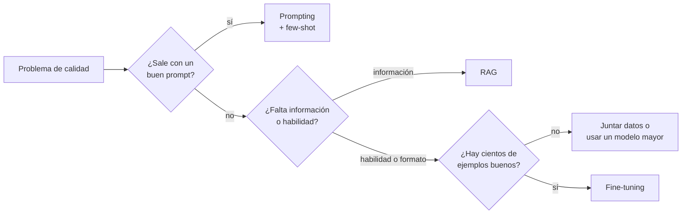

**Objetivo:** decidir si un problema se resuelve con prompting, con RAG o con fine-tuning, y saber qué datos y costos implica entrenar.

## Idea

**Fine-tuning** es seguir entrenando un modelo ya entrenado con ejemplos propios, para que cambie su comportamiento. No es la primera herramienta: casi siempre se prueba antes con prompt y con contexto.

| Técnica | Cambia | Bueno para | Malo para |
|---|---|---|---|
| **Prompting** | Las instrucciones de cada llamada | Casi todo al principio; iterar rápido | Comportamientos que no entran en un prompt o que el modelo no sigue de forma estable |
| **RAG** (ver el módulo de RAG) | El conocimiento disponible en cada llamada | Hechos, documentos, datos que cambian, citar fuentes | Estilo, formato, habilidades nuevas |
| **Fine-tuning** | Los pesos del modelo | Formato y estilo consistentes, tareas angostas repetidas, que un modelo chico haga lo que hacía uno grande | Enseñar hechos nuevos o cambiantes |

La frase para recordar: **RAG para conocimiento, fine-tuning para comportamiento.**

### Cómo decidir

### Motivos válidos para fine-tunear

- **Formato o estilo estricto** que el prompt no logra de forma estable (un JSON con una estructura interna complicada, un tono de marca).
- **Tarea angosta y de alto volumen** (clasificar, extraer, rutear) donde un modelo chico fine-tuneado iguala a uno grande y cuesta una fracción.
- **Destilación**: usar las salidas de un modelo grande como datos para entrenar uno chico.
- **Prompts gigantes repetidos**: si cada llamada lleva 3.000 tokens de instrucciones y ejemplos, entrenar ese comportamiento ahorra costo y latencia.
- **Requisito de correr local** con un modelo chico que no rinde sin ajuste.

### Tipos de fine-tuning

| Tipo | Qué ajusta | Datos |
|---|---|---|
| **SFT** (supervised fine-tuning) | Imitar respuestas de ejemplo | Pares entrada → salida esperada, en formato de mensajes |
| **Preferencias (DPO y similares)** | Preferir una respuesta sobre otra | Una entrada con una respuesta elegida y una rechazada |
| **Full fine-tuning** | Todos los pesos | Mucha GPU; se usa poco fuera de laboratorios |
| **PEFT (LoRA, QLoRA)** | Una fracción chica de parámetros extra | El estándar en la práctica; ver el capítulo siguiente |

### Los datos son el trabajo

La calidad del fine-tuning depende casi solo de los datos:

- **Cantidad**: cientos de ejemplos buenos ya mueven el comportamiento en tareas angostas; miles para algo más general.
- **Calidad**: cada ejemplo es exactamente la respuesta que querés. Un 5% de ejemplos malos se aprende igual.
- **Cobertura**: los casos borde que te importan tienen que estar.
- **Separación**: un set de evaluación que el modelo nunca ve al entrenar.
- **Formato**: el mismo chat template y las mismas instrucciones que vas a usar en producción.

### Costos

Además de las GPUs para entrenar: armar y limpiar datos, evaluar cada versión, servir el modelo (ver Servir modelos) y repetir todo cuando cambia la tarea o sale un modelo base mejor.

## Errores comunes

- Fine-tunear para que el modelo "sepa" la documentación de la empresa: eso es RAG.
- Entrenar sin un set de evaluación separado y sin medir contra el prompting.
- Pocos ejemplos, inconsistentes entre sí.
- Entrenar con un formato de prompt y usarlo en producción con otro.
- Olvidar el costo de mantener el modelo cuando sale una versión base nueva.

## Preguntas de repaso

- **¿RAG o fine-tuning?** RAG para darle conocimiento actualizable y citable; fine-tuning para cambiar comportamiento, formato o estilo, o para que un modelo chico resuelva una tarea angosta.
- **¿Qué datos necesitás para SFT?** Ejemplos de entrada y salida ideal en formato de mensajes, consistentes, con los casos borde, y un set separado para evaluar.
- **¿Cuándo conviene fine-tunear un modelo chico?** Con tareas angostas y de alto volumen, donde un modelo chico ajustado iguala al grande a menor costo y latencia.
