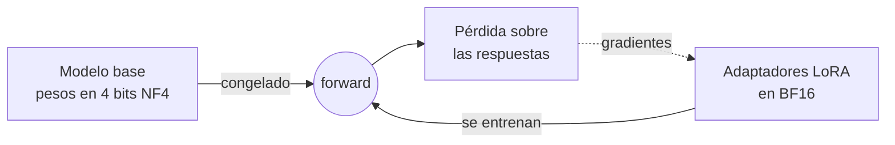

**Objetivo:** entender cómo LoRA ajusta un modelo entrenando una fracción mínima de parámetros, cómo QLoRA lo hace entrar en una sola GPU, y escribir un entrenamiento con peft y trl.

## Idea

### El problema del fine-tuning completo

Ajustar todos los pesos de un modelo de 8B exige guardar en memoria los pesos, sus gradientes y el estado del optimizador: varias veces el tamaño del modelo. Además, cada versión ajustada es una copia completa de 16 GB.

### LoRA: aprender solo una corrección chica

**LoRA** (Low-Rank Adaptation) congela los pesos originales `W` y agrega al lado dos matrices chicas `A` y `B`. El modelo usa `W + B·A`. Solo se entrenan `A` y `B`.

<figure class="diagram">
<svg viewBox="0 0 720 270" role="img" aria-label="LoRA: la matriz de pesos W congelada más el producto de dos matrices chicas B y A que se entrenan">
<defs><marker id="ah" viewBox="0 0 10 10" refX="9" refY="5" markerWidth="7" markerHeight="7" orient="auto-start-reverse"><path class="arrowhead" d="M0,0 L10,5 L0,10 z"/></marker></defs>
<line class="line" x1="200" y1="130" x2="235" y2="130" marker-end="url(#ah)"/>
<line class="line" x1="600" y1="130" x2="635" y2="130" marker-end="url(#ah)"/>
<rect class="input" x="20" y="105" width="180" height="50" rx="8"/>
<text x="110" y="128" text-anchor="middle" class="title">entrada x</text>
<text x="110" y="145" text-anchor="middle" class="sub">d = 4096</text>
<rect class="node" x="240" y="30" width="100" height="200" rx="8"/>
<text x="290" y="125" text-anchor="middle" class="title">W</text>
<text x="290" y="145" text-anchor="middle" class="sub">4096 × 4096</text>
<text x="290" y="162" text-anchor="middle" class="sub">congelada</text>
<text x="358" y="135" text-anchor="middle" class="title">+</text>
<rect class="process" x="380" y="30" width="22" height="200" rx="4"/>
<text x="391" y="250" text-anchor="middle" class="sub">B</text>
<text x="421" y="135" text-anchor="middle" class="title">·</text>
<rect class="process" x="440" y="110" width="150" height="22" rx="4"/>
<text x="515" y="100" text-anchor="middle" class="sub">A</text>
<text x="490" y="175" text-anchor="middle" class="sub">rango r = 16</text>
<text x="490" y="193" text-anchor="middle" class="sub">se entrenan</text>
<rect class="store" x="640" y="105" width="70" height="50" rx="8"/>
<text x="675" y="135" text-anchor="middle" class="title">h</text>
</svg>
<figcaption>W tiene ~16,8 millones de parámetros; B (4096 × 16) y A (16 × 4096) suman ~131 mil: menos del 1% por capa.</figcaption>
</figure>

Hiperparámetros principales:

| Parámetro | Qué controla | Valores típicos |
|---|---|---|
| `r` (rango) | Capacidad del ajuste: cuántos "grados de libertad" tiene la corrección | 8 a 64 |
| `lora_alpha` | Escala de la corrección (`alpha / r`) | 16 a 2 × r |
| `target_modules` | A qué capas se agregan adaptadores | Proyecciones de atención y MLP (`q_proj`, `k_proj`, `v_proj`, `o_proj`, `gate_proj`, `up_proj`, `down_proj`) |
| `lora_dropout` | Regularización | 0 a 0.1 |

Ventajas además de la memoria:

- El resultado es un **adaptador** de pocas decenas de MB, no una copia del modelo.
- Un mismo modelo base puede servir **varios adaptadores** (uno por cliente o por tarea) y elegir cuál usar en cada request.
- El adaptador se puede **fusionar** con el modelo base para servirlo como un modelo común.

### QLoRA: base cuantizada + adaptadores

**QLoRA** carga el modelo base cuantizado a 4 bits (formato NF4) y entrena adaptadores LoRA en precisión normal encima. La memoria de los pesos base cae a un cuarto: un modelo de 8B se puede ajustar en una GPU de 24 GB, y uno de 70B en una de 48–80 GB.



### Formato de los datos

Cada ejemplo es una conversación en el mismo formato de mensajes que se usa en producción. El entrenador aplica el chat template del modelo y, normalmente, calcula la pérdida solo sobre las respuestas del assistant.

```json
{"messages": [
  {"role": "system", "content": "Classify the ticket as billing, bug or other."},
  {"role": "user", "content": "I was charged twice in October."},
  {"role": "assistant", "content": "billing"}
]}
```

## Cómo se implementa

`peft` define los adaptadores y `trl` trae `SFTTrainer`, que se encarga del chat template, la tokenización y el loop de entrenamiento.

**LoRA** sobre un modelo base en BF16:

```python
from datasets import load_dataset
from peft import LoraConfig
from trl import SFTConfig, SFTTrainer

dataset = load_dataset("json", data_files={"train": "train.jsonl", "test": "test.jsonl"})

peft_config = LoraConfig(
    r=16,
    lora_alpha=32,
    lora_dropout=0.05,
    target_modules=["q_proj", "k_proj", "v_proj", "o_proj", "gate_proj", "up_proj", "down_proj"],
    task_type="CAUSAL_LM",
)
args = SFTConfig(
    output_dir="qwen3-tickets-lora",
    num_train_epochs=3,
    per_device_train_batch_size=4,
    gradient_accumulation_steps=4,
    learning_rate=2e-4,
    max_length=2048,
    assistant_only_loss=True,      # learn only from the assistant turns
    bf16=True,
)
trainer = SFTTrainer(
    model="Qwen/Qwen3-8B",
    args=args,
    train_dataset=dataset["train"],
    eval_dataset=dataset["test"],
    peft_config=peft_config,
)
trainer.train()
trainer.save_model()               # saves only the adapter
```

**QLoRA**: el mismo código, con el modelo base cargado en 4 bits.

```python
from transformers import BitsAndBytesConfig

quantization = BitsAndBytesConfig(
    load_in_4bit=True,
    bnb_4bit_quant_type="nf4",
    bnb_4bit_compute_dtype="bfloat16",
    bnb_4bit_use_double_quant=True,
)
trainer = SFTTrainer(
    model="Qwen/Qwen3-8B",
    args=args,
    train_dataset=dataset["train"],
    eval_dataset=dataset["test"],
    peft_config=peft_config,
    quantization_config=quantization,
)
trainer.train()
```

**Usar el adaptador**: cargarlo sobre el base, o fusionarlo para tener un modelo común.

```python
from peft import PeftModel
from transformers import AutoModelForCausalLM

base = AutoModelForCausalLM.from_pretrained("Qwen/Qwen3-8B", dtype="bfloat16", device_map="auto")
model = PeftModel.from_pretrained(base, "qwen3-tickets-lora")

merged = model.merge_and_unload()          # W + B·A folded into the weights
merged.save_pretrained("qwen3-tickets-merged")
```

**Servir varios adaptadores** sobre un mismo base con vLLM: cada adaptador se pide por nombre en el campo `model`.

```sh
vllm serve Qwen/Qwen3-8B --enable-lora --lora-modules tickets=./qwen3-tickets-lora
```

```python
client.chat.completions.create(model="tickets", messages=messages)
```

## Errores comunes

- Entrenar con un learning rate de full fine-tuning: LoRA usa valores más altos (del orden de 1e-4 a 2e-4).
- Calcular la pérdida sobre todo el texto, incluido el prompt, cuando se quería aprender solo las respuestas.
- Muchas épocas sobre pocos datos: el modelo memoriza y empeora fuera del set de entrenamiento.
- No comparar contra el modelo base con un buen prompt (ver el capítulo siguiente).

## Preguntas de repaso

- **¿Cómo funciona LoRA?** Congela los pesos originales y entrena dos matrices de rango bajo cuyo producto se suma a cada capa elegida; se entrena menos del 1% de los parámetros.
- **¿Qué agrega QLoRA?** Carga el modelo base cuantizado a 4 bits y entrena los adaptadores encima, lo que permite ajustar modelos grandes en una sola GPU.
- **¿Qué controla el rango `r`?** La capacidad del adaptador: más rango, más parámetros entrenables y más capacidad de cambio.
- **¿Qué ventaja operativa tienen los adaptadores?** Son livianos, se versionan aparte y un mismo modelo base puede servir varios.
