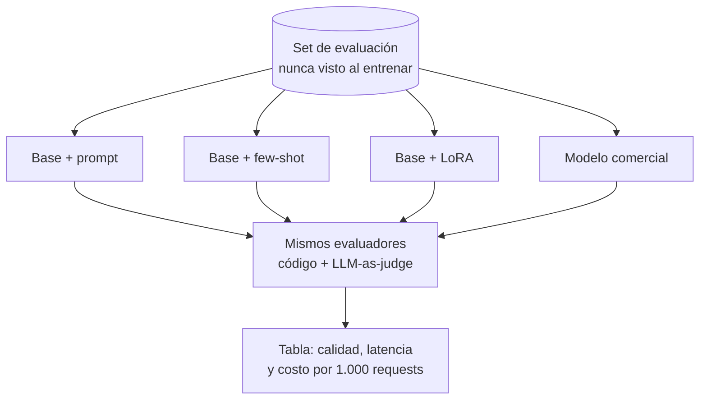

**Objetivo:** decidir con números si un modelo fine-tuneado le gana al modelo base con un buen prompt, o a un modelo comercial.

## Idea

Un fine-tuning solo vale si mejora algo medible frente a la alternativa más barata. La comparación es un experimento como los del módulo de Evals y observabilidad, con un detalle: los candidatos son modelos distintos.

### Los candidatos

| Candidato | Qué representa |
|---|---|
| Modelo base + prompt simple | La línea base mínima |
| Modelo base + mejor prompt (few-shot) | Lo que se logra sin entrenar |
| Modelo base + adaptador LoRA | El fine-tuning |
| Modelo comercial grande | El techo de calidad y la referencia de costo |

### El experimento



Reglas para que la comparación sea justa:

- **El set de evaluación no se usó para entrenar** ni para elegir hiperparámetros.
- **Los mismos evaluadores** para todos: checks deterministas primero, juez LLM para lo que necesita leer el texto.
- **El mismo formato de prompt** que el modelo vio al entrenar, para el candidato fine-tuneado.
- **Calidad, latencia y costo juntos**: un modelo chico ajustado que empata en calidad y cuesta diez veces menos es una victoria.
- **Repeticiones** si hay sampling, y mirar caso por caso qué cambió.

### Qué mirar además del promedio

- **Regresiones**: casos que el base resolvía y el ajustado ya no. El fine-tuning puede hacer olvidar capacidades generales.
- **Casos fuera de distribución**: entradas distintas a las de entrenamiento.
- **Formato**: si el objetivo era formato, la tasa de salidas válidas es la métrica principal.

## Cómo se ve en código

Como vLLM sirve el base y el adaptador detrás de la misma API (el adaptador se pide por nombre), comparar es correr el mismo loop con distintos `model`.

```python
import time
from openai import OpenAI

local = OpenAI(base_url="http://localhost:8000/v1", api_key="local")

CANDIDATES = {
    "base": ("Qwen/Qwen3-8B", BASE_PROMPT),
    "base-few-shot": ("Qwen/Qwen3-8B", FEW_SHOT_PROMPT),
    "lora": ("tickets", TRAINING_PROMPT),            # adapter served with --lora-modules
}

def run(model: str, system: str, case: dict) -> dict:
    start = time.perf_counter()
    completion = local.chat.completions.create(
        model=model,
        messages=[{"role": "system", "content": system}, {"role": "user", "content": case["input"]}],
        max_tokens=64,
    )
    answer = completion.choices[0].message.content.strip()
    return {"correct": answer == case["expected"], "latency": time.perf_counter() - start,
            "tokens": completion.usage.total_tokens}

for name, (model, system) in CANDIDATES.items():
    results = [run(model, system, case) for case in test_set]
    accuracy = sum(r["correct"] for r in results) / len(results)
    p95 = sorted(r["latency"] for r in results)[int(len(results) * 0.95) - 1]
    print(f"{name:<14} accuracy={accuracy:.2%}  p95={p95:.2f}s")
```

El modelo comercial entra en la misma tabla con su propio cliente, y los evaluadores con LLM-as-judge del módulo de Evals y observabilidad reemplazan a `answer == case["expected"]` cuando la salida es texto libre.

## Errores comunes

- Evaluar el modelo ajustado con datos que vio al entrenar.
- Comparar el fine-tuning contra un prompt malo en vez del mejor prompt posible.
- Reportar solo calidad y olvidar costo y latencia, que suelen ser la razón del fine-tuning.
- No revisar regresiones en capacidades generales.

## Preguntas de repaso

- **¿Cómo demostrás que un fine-tuning valió la pena?** Comparándolo con el modelo base con el mejor prompt y con un modelo comercial, sobre un set de evaluación no usado al entrenar, midiendo calidad, latencia y costo.
- **¿Qué riesgo tiene fine-tunear sobre capacidades generales?** Que el modelo empeore en tareas fuera de las de entrenamiento; se detecta con casos fuera de distribución en la evaluación.
- **¿Por qué servir base y adaptador en el mismo servidor facilita la comparación?** Porque el código de evaluación es idéntico y solo cambia el nombre del modelo.
