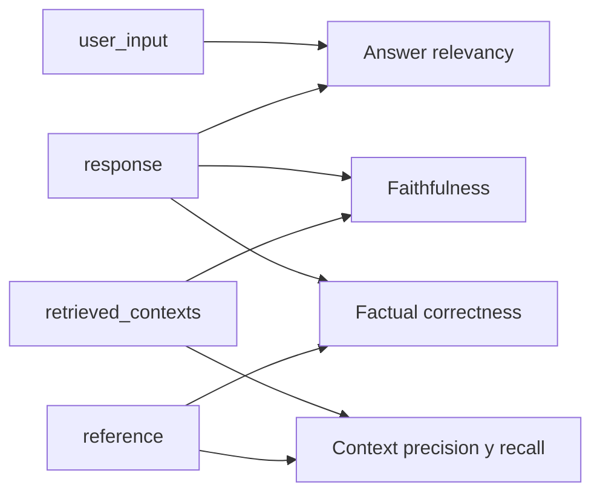

**Objetivo:** entender qué mide Ragas, qué datos necesita de cada consulta y cómo un juez LLM convierte texto libre en un número.

## Idea

Ragas es una librería de Python para evaluar aplicaciones con LLM, nacida para RAG. Su aporte central es un catálogo de **métricas ya diseñadas** para cada etapa de un RAG: si el retriever trajo lo necesario, si la respuesta sale del contexto, si responde lo que se preguntó y si coincide con la referencia. A eso suma generación de datasets sintéticos a partir de tus documentos y una forma de correr experimentos comparables.

No reemplaza tu criterio: automatiza la parte repetitiva de leer cientos de respuestas y decidir si están bien.

### La muestra: qué se registra de cada consulta

Cada métrica trabaja sobre una **muestra** con hasta cuatro campos. Conviene registrarlos siempre, aunque al principio no uses todas las métricas.

| Campo | Qué es | De dónde sale |
|---|---|---|
| `user_input` | La pregunta del usuario | El dataset |
| `retrieved_contexts` | Los chunks que el retriever pasó al LLM | Tu pipeline, en cada corrida |
| `response` | Lo que respondió el sistema | Tu pipeline, en cada corrida |
| `reference` | La respuesta correcta escrita por una persona (o generada y revisada) | El dataset |

Las métricas **sin referencia** (faithfulness, answer relevancy, context relevance) se pueden calcular también sobre tráfico real de producción. Las que usan `reference` (context recall, context precision, factual correctness) necesitan un dataset etiquetado.



### Cómo calcula un número a partir de texto

Casi todas las métricas de Ragas siguen el mismo patrón en dos pasos:

1. **Descomponer**: un LLM parte un texto (la respuesta, o la referencia) en **afirmaciones atómicas**, frases que se pueden verificar una por una. "El director de finanzas lo aprueba y tarda cinco días" son dos afirmaciones.
2. **Verificar**: otro llamado decide para cada afirmación si está respaldada por un texto de comparación (el contexto, o la referencia). Devuelve un veredicto binario por afirmación.

El puntaje es una proporción: afirmaciones respaldadas sobre el total. Por eso las métricas dan valores entre 0 y 1, y por eso son más estables que pedirle al juez "poné una nota del 1 al 10": cada veredicto individual es una pregunta de sí o no.

Algunas métricas no siguen este patrón: answer relevancy genera preguntas a partir de la respuesta y las compara con embeddings, y las métricas de herramientas de agentes son comparaciones exactas sin LLM. Se ven en sus capítulos.

> [!IMPORTANT]
> Un puntaje de Ragas es la opinión de un modelo, no una medición física. Dos corridas sobre los mismos datos pueden variar un poco, y el juez se equivoca. Usalo para comparar versiones de tu sistema sobre el mismo dataset y revisá a mano una muestra de los veredictos.

### El juez

Ragas no trae modelo propio: le pasás un **LLM juez** (y, para algunas métricas, un modelo de **embeddings**). El juez tiene que poder devolver salida estructurada, porque cada paso pide un JSON con afirmaciones o veredictos.

Reglas prácticas para elegirlo:

- **Fuerte y fijo.** Un juez débil produce veredictos ruidosos. Si cambiás el juez, los números dejan de ser comparables con las corridas anteriores.
- **Distinto del generador** cuando se pueda, para reducir la auto-preferencia.
- **Costo**: cada métrica hace uno o varios llamados por muestra. Cinco métricas sobre 200 preguntas son miles de llamados.

### API actual y tutoriales viejos

La mayoría de los tutoriales en internet usan la API original: un `EvaluationDataset` y una función `evaluate(dataset, metrics=[...])` que devolvía una tabla. La API actual separa las piezas: cada métrica se instancia con su juez y se llama con argumentos explícitos (`ascore(user_input=..., response=...)`), y las corridas sobre un dataset se arman con experimentos (capítulo 5). Los conceptos y los nombres de las métricas son los mismos.

## Cómo se implementa

Configurar el juez y los embeddings. `llm_factory` envuelve un cliente con interfaz OpenAI; el resto de las métricas solo reciben el objeto que devuelve.

:::tabs
== OpenAI
```python
from openai import AsyncOpenAI
from ragas.embeddings import embedding_factory
from ragas.llms import llm_factory

client = AsyncOpenAI()
judge = llm_factory("gpt-5.6-luna", client=client, max_tokens=8192)
embeddings = embedding_factory("openai", model="text-embedding-3-small", client=client)
```
== Ollama
Un juez local, útil cuando los datos no pueden salir de tu infraestructura. Ollama expone una API compatible con OpenAI, así que se usa el mismo cliente.

```python
from openai import AsyncOpenAI
from ragas.embeddings import embedding_factory
from ragas.llms import llm_factory

client = AsyncOpenAI(base_url="http://localhost:11434/v1", api_key="ollama")
judge = llm_factory("qwen3", client=client, max_tokens=8192)
embeddings = embedding_factory("openai", model="nomic-embed-text", client=client)
```
:::

Calcular una métrica sobre una muestra. Las métricas son asíncronas: `ascore` para una muestra, `abatch_score` para varias en paralelo. El resultado es un `MetricResult` con `.value`.

```python
from ragas.metrics.collections import Faithfulness

faithfulness = Faithfulness(llm=judge)

result = await faithfulness.ascore(
    user_input="Who approves a 3,500 USD refund?",
    response="The finance director approves it, and it takes five business days.",
    retrieved_contexts=["Refunds above 2,000 USD need approval from the finance director."],
)
print(result.value)  # 0.5: "five business days" is not supported by the context

results = await faithfulness.abatch_score([
    {"user_input": q, "response": a, "retrieved_contexts": ctx} for q, a, ctx in samples
])
```

## Errores comunes

- Guardar solo la respuesta final y no los `retrieved_contexts`: después no se puede calcular ninguna métrica de retrieval ni faithfulness.
- Cambiar el modelo juez entre corridas y comparar los números como si fueran la misma escala.
- Leer un 0.82 como "82% correcto". Es la proporción de afirmaciones que el juez consideró respaldadas, no la tasa de respuestas correctas.
- Correr diez métricas sobre todo el dataset sin mirar el costo: cada una multiplica los llamados al juez.
- Usar el mismo modelo, con el mismo prompt, como generador y como juez sin validar contra etiquetas humanas.

## Preguntas de repaso

- **¿Qué datos necesita Ragas de cada consulta?** Pregunta, contextos recuperados, respuesta y, para las métricas con referencia, la respuesta correcta.
- **¿Cómo convierte una respuesta en un número?** Descompone el texto en afirmaciones atómicas, le pide al juez un veredicto binario por cada una y devuelve la proporción de respaldadas.
- **¿Qué métricas se pueden usar en producción, sin dataset etiquetado?** Las que no usan `reference`: faithfulness, answer relevancy y context relevance.
- **¿Por qué el juez debe quedar fijo?** Porque cada juez tiene su propio sesgo; cambiarlo mueve los puntajes aunque el sistema no haya cambiado.
