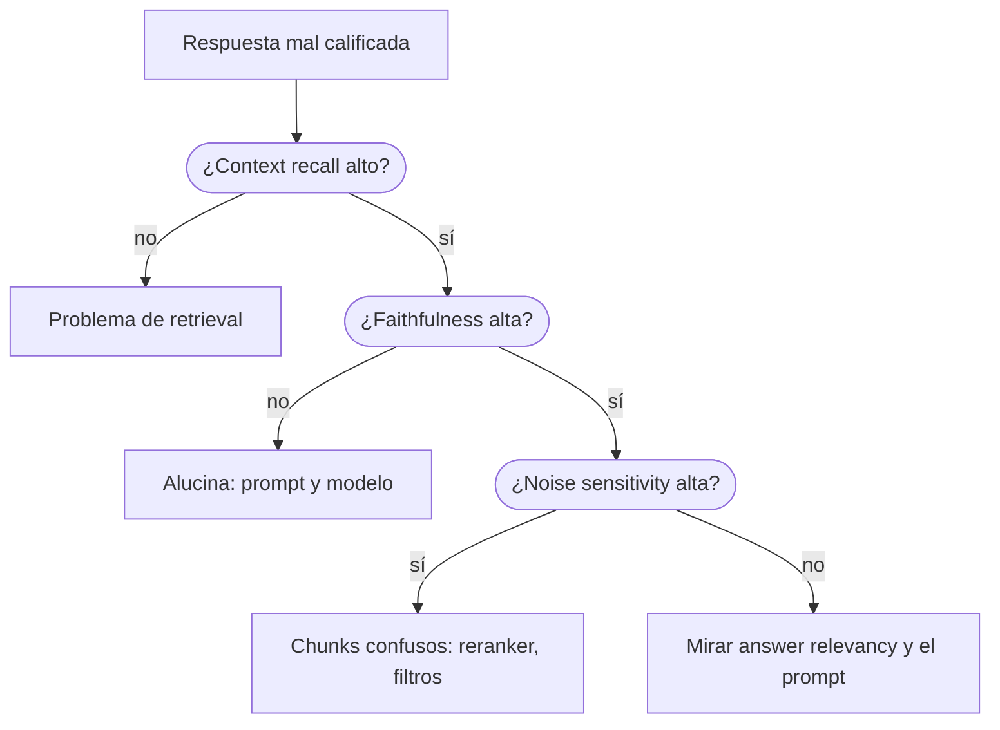

**Objetivo:** medir si la respuesta sale del contexto, si responde lo que se preguntó y si es correcta, y distinguir una alucinación de un error de retrieval.

## Idea

Con un contexto bueno, la respuesta todavía puede fallar de tres formas: inventar datos que no están en el contexto, irse por las ramas sin responder, o decir algo que no coincide con la respuesta correcta. Cada falla tiene su métrica, y conviene no mezclarlas.

| Métrica | Pregunta | Compara | Necesita referencia |
|---|---|---|---|
| **Faithfulness** | ¿Cada afirmación está respaldada por el contexto? | respuesta vs contexto | No |
| **Response groundedness** | ¿La respuesta está apoyada en el contexto? (juicio global) | respuesta vs contexto | No |
| **Answer relevancy** | ¿Responde lo que se preguntó? | respuesta vs pregunta | No |
| **Factual correctness** | ¿Dice lo mismo que la referencia? | respuesta vs referencia | Sí |
| **Answer accuracy** | ¿Coincide con la referencia? (juicio global) | respuesta vs referencia | Sí |
| **Noise sensitivity** | ¿Cuántos errores vienen de chunks que la confundieron? | respuesta, contexto y referencia | Sí |

### Faithfulness

Mide alucinación respecto del contexto:

1. El juez descompone la respuesta en afirmaciones.
2. Para cada una decide si se puede inferir del contexto recuperado.
3. Puntaje = afirmaciones respaldadas / total.

Una respuesta puede ser **fiel y falsa** (el contexto estaba desactualizado y la respuesta lo repitió bien) o **correcta e infiel** (el modelo acertó con conocimiento propio, sin apoyo en el contexto). En un RAG las dos son problemas: la segunda significa que la respuesta no es verificable con tus documentos.

**Response groundedness** responde la misma pregunta con otro método: dos prompts de juez califican la respuesta completa con 0, 1 o 2 y se promedian. Es más barata (no descompone en afirmaciones) y menos explicable.

### Answer relevancy

Mide si la respuesta apunta a la pregunta, no si es correcta:

1. El juez genera varias preguntas que la respuesta respondería (por defecto, tres).
2. Se calcula la similitud coseno entre los embeddings de esas preguntas y la pregunta original.
3. Puntaje = promedio de las similitudes. Si el juez detecta una respuesta evasiva ("no estoy seguro", "depende"), el puntaje es 0.

Una respuesta que agrega mucha información que nadie pidió genera preguntas que se alejan de la original y baja el puntaje. Por eso esta métrica necesita **embeddings** además del juez.

### Factual correctness

Compara la respuesta con la referencia afirmación por afirmación, en las dos direcciones:

- **Verdaderos positivos (TP)**: afirmaciones de la respuesta que la referencia respalda.
- **Falsos positivos (FP)**: afirmaciones de la respuesta que la referencia no respalda.
- **Falsos negativos (FN)**: afirmaciones de la referencia que faltan en la respuesta.

Con eso calcula precision = TP / (TP + FP), recall = TP / (TP + FN) o F1. El modo se elige según qué te importa: **precision** castiga inventar, **recall** castiga omitir, **F1** balancea. Dos parámetros controlan la granularidad de la descomposición: *atomicity* (cuánto se parte cada frase) y *coverage* (cuánto detalle de la frase se conserva).

**Answer accuracy** es la versión global: dos jueces califican con 0, 1 o 2 cuánto coincide la respuesta con la referencia.

### Noise sensitivity

Mide cuántas afirmaciones **incorrectas** de la respuesta están respaldadas por chunks del contexto. Detecta el caso en que el retriever trajo un chunk que confundió al modelo (otra política, otro producto, una versión vieja) y el modelo lo usó. Menor es mejor. Tiene dos modos: errores que vienen de chunks relevantes o de chunks irrelevantes.

### Diagnóstico combinado



## Cómo se implementa

Mismo caso en los dos tabs: la respuesta agrega un plazo que no está en el contexto.

:::tabs
== Ragas
```python
from ragas.metrics.collections import AnswerRelevancy, FactualCorrectness, Faithfulness

question = "Who approves a 3,500 USD refund?"
answer = "The finance director approves it, and the money arrives in five business days."
contexts = ["Refunds above 2,000 USD need approval from the finance director."]
reference = "The finance director approves it, with the ticket number attached."

faithfulness = await Faithfulness(llm=judge).ascore(
    user_input=question, response=answer, retrieved_contexts=contexts)
relevancy = await AnswerRelevancy(llm=judge, embeddings=embeddings).ascore(
    user_input=question, response=answer)
correctness = await FactualCorrectness(llm=judge, mode="precision").ascore(
    response=answer, reference=reference)

print(faithfulness.value, relevancy.value, correctness.value)
```
== DeepEval
DeepEval no tiene factual correctness como métrica propia; la comparación contra la referencia se arma con `GEval` (ver LLM-as-judge en el módulo de Evals y observabilidad).

```python
from deepeval.metrics import AnswerRelevancyMetric, FaithfulnessMetric
from deepeval.models import AnthropicModel
from deepeval.test_case import LLMTestCase

judge = AnthropicModel(model="claude-opus-5-5")
case = LLMTestCase(input=question, actual_output=answer, retrieval_context=contexts)

for metric in (FaithfulnessMetric(model=judge), AnswerRelevancyMetric(model=judge)):
    metric.measure(case)
    print(type(metric).__name__, metric.score, metric.reason)
```
:::

## Errores comunes

- Tomar faithfulness alta como "respuesta correcta": solo dice que no inventó respecto del contexto.
- Usar answer relevancy para medir corrección: una respuesta equivocada pero enfocada puntúa alto.
- Elegir F1 en factual correctness cuando lo que importa es no inventar: precision es la que castiga afirmaciones sin respaldo.
- Evaluar generación sin mirar retrieval: la mitad de las "alucinaciones" son contexto faltante.
- Comparar puntajes de answer relevancy calculados con distintos modelos de embeddings.

## Preguntas de repaso

- **¿Qué mide faithfulness y cómo se calcula?** La proporción de afirmaciones de la respuesta que se pueden inferir del contexto recuperado; el juez descompone y verifica cada una.
- **¿Puede una respuesta ser fiel e incorrecta?** Sí: si el contexto tiene un dato equivocado o viejo y la respuesta lo repite bien.
- **¿Cómo funciona answer relevancy?** Genera preguntas que la respuesta respondería, las compara con la pregunta original por similitud de embeddings y devuelve 0 si la respuesta es evasiva.
- **¿Para qué sirven los modos de factual correctness?** Precision castiga inventar, recall castiga omitir y F1 equilibra ambas.
- **¿Qué detecta noise sensitivity?** Errores de la respuesta que salen de chunks recuperados que confundieron al modelo.
