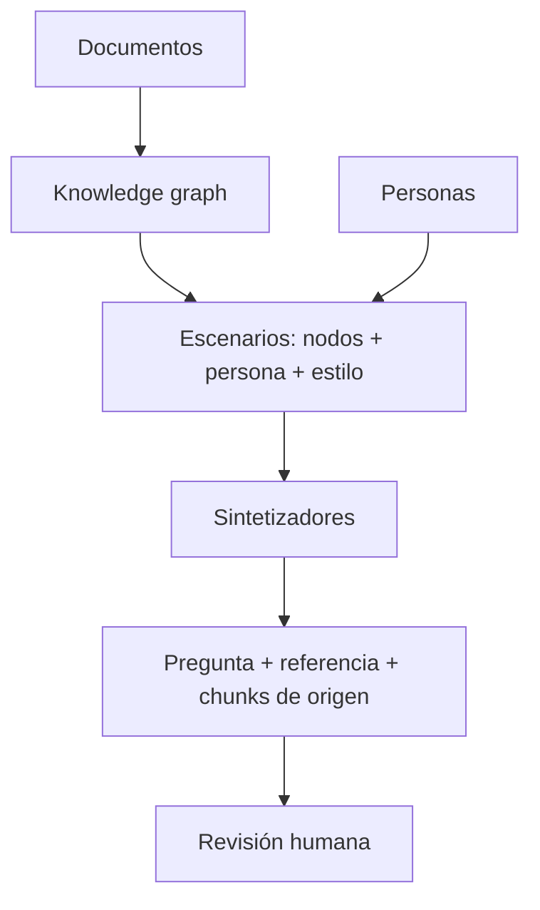

**Objetivo:** generar un primer set de preguntas con referencia a partir del corpus, con variedad de dificultad y de usuarios, y saber qué revisar antes de usarlo.

## Idea

Sin dataset no hay evaluación, y al principio no hay preguntas reales de usuarios. La generación sintética le pide a un LLM que lea tus documentos y escriba preguntas, cada una con su **respuesta de referencia** y los **chunks de origen**. Es la forma rápida de arrancar; después se reemplaza de a poco con preguntas reales de producción.

El problema de lo sintético ingenuo ("generá una pregunta sobre este chunk") es que produce preguntas fáciles, con las mismas palabras del texto, que cualquier retriever encuentra. Ragas ataca eso con tres ideas.

### 1. Un grafo de conocimiento del corpus

Antes de generar, Ragas arma un **knowledge graph**:

- **Nodos**: los documentos y los chunks en que se parten.
- **Propiedades** extraídas con el LLM y con embeddings: títulos, resumen, entidades, temas, embedding de cada chunk.
- **Relaciones** entre nodos: similitud de embeddings, entidades en común, temas compartidos.

Las relaciones permiten armar preguntas que **cruzan** varios chunks, que son las que de verdad ponen a prueba un RAG.

### 2. Personas y estilos

Una **persona** es un tipo de usuario con su rol ("agente de soporte que responde tickets de reembolso", "cliente nuevo que no conoce la terminología"). Cada pregunta se genera desde una persona, con un **estilo** (formal, coloquial, con errores de tipeo) y un **largo**. Así el dataset se parece a cómo pregunta la gente y no a cómo está escrito el manual. Si no definís personas, Ragas las infiere de los documentos.

### 3. Sintetizadores por tipo de pregunta

| Sintetizador | Qué genera | Ejemplo |
|---|---|---|
| **Single-hop specific** | Pregunta concreta que se responde con un chunk | "¿Quién aprueba un reembolso de 3.500 USD?" |
| **Multi-hop specific** | Pregunta concreta que necesita datos de varios chunks | "¿Qué tiene que adjuntar un agente para un reembolso que necesita al director de finanzas?" |
| **Multi-hop abstract** | Pregunta interpretativa o de resumen sobre varios chunks | "¿Cómo cambia el proceso de reembolso según el monto?" |

La **query distribution** decide la proporción de cada tipo. La distribución por defecto es 50% single-hop y 25% de cada multi-hop.



### Qué revisar antes de confiar en él

- **Respuestas de referencia**: el generador puede equivocarse igual que tu sistema. Un experto revisa cada una, o al menos una muestra grande.
- **Preguntas imposibles o ambiguas**: descartarlas o reescribirlas.
- **Cobertura**: agregá a mano lo que el generador no produce, sobre todo preguntas **sin respuesta** en el corpus (el sistema tiene que decir que no sabe).
- **Sesgo**: el dataset sintético mide qué tan bien responde tu sistema a preguntas escritas por un LLM leyendo tus documentos. Las preguntas reales de producción van reemplazándolo.

> [!TIP]
> Guardá el dataset generado en un archivo versionado y no lo regeneres en cada corrida. Si las preguntas cambian, los puntajes dejan de ser comparables.

## Cómo se implementa

Mismo corpus (el handbook de soporte) y mismo objetivo en los dos tabs: diez preguntas, mitad de un chunk y mitad de varios.

:::tabs
== Ragas
El generador recibe el juez y los embeddings del capítulo 1. Los documentos entran como `Document` de LangChain (texto + metadata).

```python
from ragas.testset import TestsetGenerator
from ragas.testset.persona import Persona
from ragas.testset.synthesizers import (
    MultiHopAbstractQuerySynthesizer,
    MultiHopSpecificQuerySynthesizer,
    SingleHopSpecificQuerySynthesizer,
)

personas = [
    Persona(name="support agent", role_description="Answers refund tickets and needs exact approval rules."),
    Persona(name="new customer", role_description="Does not know the internal terms and writes informally."),
]
generator = TestsetGenerator(llm=judge, embedding_model=embeddings, persona_list=personas)

testset = generator.generate_with_langchain_docs(
    docs,
    testset_size=10,
    query_distribution=[
        (SingleHopSpecificQuerySynthesizer(llm=judge), 0.5),
        (MultiHopSpecificQuerySynthesizer(llm=judge), 0.25),
        (MultiHopAbstractQuerySynthesizer(llm=judge), 0.25),
    ],
)
df = testset.to_pandas()  # user_input, reference_contexts, reference, synthesizer_name...
```
== DeepEval
El `Synthesizer` de DeepEval genera *goldens* (pregunta, respuesta esperada y contexto) y "evoluciona" cada pregunta para hacerla más difícil: razonamiento, varios contextos, comparación, hipótesis.

```python
from deepeval.models import AnthropicModel
from deepeval.synthesizer import Evolution, Synthesizer
from deepeval.synthesizer.config import EvolutionConfig

synthesizer = Synthesizer(
    model=AnthropicModel(model="claude-opus-5-5"),
    evolution_config=EvolutionConfig(
        num_evolutions=1,
        evolutions={Evolution.MULTICONTEXT: 0.5, Evolution.REASONING: 0.5},
    ),
)
goldens = synthesizer.generate_goldens_from_docs(
    document_paths=["handbook/refunds.md", "handbook/shipping.md"],
    include_expected_output=True,
    max_goldens_per_context=2,
)
print(goldens[0].input, goldens[0].expected_output)
```
:::

## Errores comunes

- Usar el dataset sintético sin que nadie revise las referencias: el sistema termina evaluado contra errores del generador.
- Generar solo single-hop: el retriever parece excelente porque las preguntas copian el texto del chunk.
- Regenerar el dataset en cada corrida: cada experimento se mide contra preguntas distintas.
- No agregar preguntas sin respuesta en el corpus.
- Quedarse con el sintético para siempre en lugar de ir sumando preguntas reales de usuarios.

## Preguntas de repaso

- **¿Para qué arma Ragas un knowledge graph antes de generar?** Para relacionar chunks por similitud, entidades y temas, y así poder generar preguntas que necesitan varios chunks.
- **¿Qué aportan las personas?** Variedad de vocabulario, intención y estilo, para que las preguntas se parezcan a las de usuarios reales y no al texto del manual.
- **¿Qué diferencia hay entre multi-hop specific y multi-hop abstract?** La primera pide datos concretos repartidos en varios chunks; la segunda pide interpretar o resumir información de varios chunks.
- **¿Qué tenés que revisar de un dataset sintético?** Las referencias, las preguntas imposibles o ambiguas, la cobertura (incluidas preguntas sin respuesta) y que no se regenere entre corridas.
