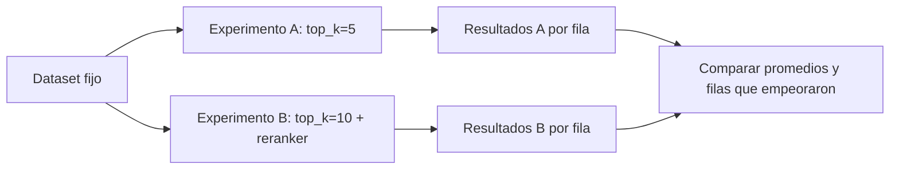

**Objetivo:** correr el sistema sobre un dataset fijo, comparar configuraciones con números, escribir métricas para criterios propios y validar al juez contra etiquetas humanas.

## Idea

Una métrica suelta sirve para mirar un caso. Para decidir si un cambio mejora el sistema hace falta un **experimento**: correr una configuración concreta sobre un dataset fijo, guardar cada respuesta con sus puntajes y compararla con la corrida anterior.



### Las piezas

- **Dataset**: las filas de entrada (pregunta, referencia, metadata). Se guarda en un backend (CSV o JSONL locales, entre otros) y se versiona junto con el código.
- **Función de experimento**: recibe una fila, ejecuta tu sistema, calcula las métricas y devuelve una fila de resultado. Puede recibir parámetros (`top_k`, modelo, prompt) para correr variantes.
- **Experimento**: el resultado de aplicar la función a todo el dataset, guardado con un nombre. Cada experimento es una tabla que se puede abrir, filtrar y comparar.

La regla de oro es la de cualquier experimento: **cambiar una cosa por vez** y comparar contra una línea base sobre el mismo dataset y con el mismo juez.

### Mirar filas, no solo promedios

Un promedio que sube de 0.81 a 0.83 puede esconder diez preguntas que empeoraron. Antes de aceptar un cambio:

1. Compará el promedio de cada métrica.
2. Listá las filas que bajaron más de un umbral.
3. Leé esas respuestas. Muchas veces el cambio arregló un tipo de pregunta y rompió otro.

### Métricas propias

Las métricas incluidas cubren lo genérico de un RAG. Tu producto tiene criterios propios: "cita el número de ticket", "no promete plazos", "usa el tono de la marca". Hay dos tipos de métrica propia:

| Tipo | Cómo decide | Cuándo |
|---|---|---|
| **Con código** | Una función de Python | Todo lo verificable de forma determinista: formato, presencia de un dato, largo, JSON válido |
| **Con juez** | Un prompt con los campos de la muestra y un conjunto de valores permitidos | Criterios que requieren leer: tono, cumplimiento de una política, completitud |

Para las de juez valen las reglas del módulo de Evals y observabilidad: un criterio por métrica, valores **discretos** (`pass`/`fail`) antes que escalas, y rúbrica explícita en el prompt.

### Alinear al juez con personas

Un juez propio recién escrito no está validado. El proceso:

1. Una persona etiqueta 50–100 respuestas con el mismo criterio.
2. El juez califica las mismas respuestas.
3. Se mide el acuerdo. Para veredictos discretos se usa **Cohen's kappa**, que descuenta el acuerdo que se daría por azar (1 = acuerdo perfecto, 0 = azar).
4. Se leen los desacuerdos y se ajusta el prompt.

Ragas suma un paso más: puede **alinear** la métrica usando las etiquetas humanas como ejemplos. Al juzgar un caso nuevo, busca por embeddings los casos etiquetados más parecidos y los agrega al prompt como ejemplos (*few-shot* dinámico). El juez aprende el criterio de tu equipo con casos concretos en lugar de solo con la rúbrica.

### Costo y repetición

Cada experimento hace muchos llamados al juez. Con un **cache** de respuestas del juez, volver a correr un experimento que no cambió (o que cambió solo en algunas filas) no vuelve a pagar los llamados repetidos.

## Cómo se implementa

Mismo experimento en los dos tabs: el RAG de reembolsos con `top_k=5`, medido con faithfulness y context recall.

:::tabs
== Ragas
El decorador `@experiment` convierte una función async por fila en un experimento; `arun` la aplica a todo el dataset y guarda el resultado con el nombre indicado.

```python
from ragas import Dataset, experiment
from ragas.cache import DiskCacheBackend
from ragas.metrics.collections import ContextRecall, Faithfulness

judge = llm_factory("gpt-5.6-luna", client=client, max_tokens=8192, cache=DiskCacheBackend())
faithfulness, recall = Faithfulness(llm=judge), ContextRecall(llm=judge)

@experiment()
async def rag_eval(row, top_k: int):
    out = await rag(row["question"], top_k=top_k)  # your pipeline: {"answer", "contexts"}
    f = await faithfulness.ascore(user_input=row["question"], response=out["answer"],
                                  retrieved_contexts=out["contexts"])
    r = await recall.ascore(user_input=row["question"], reference=row["reference"],
                            retrieved_contexts=out["contexts"])
    return {**row, "response": out["answer"], "faithfulness": f.value, "context_recall": r.value}

dataset = Dataset.load(name="refunds", backend="local/csv", root_dir="evals")
baseline = await rag_eval.arun(dataset, name="top_k_5", top_k=5)
print(baseline.to_pandas()[["faithfulness", "context_recall"]].mean())
```
== DeepEval
`evaluate` corre las métricas sobre una lista de casos; `hyperparameters` deja registrada la configuración de la corrida para compararla después.

```python
from deepeval import evaluate
from deepeval.metrics import ContextualRecallMetric, FaithfulnessMetric
from deepeval.test_case import LLMTestCase

cases = []
for row in rows:
    out = rag(row["question"], top_k=5)
    cases.append(LLMTestCase(input=row["question"], actual_output=out["answer"],
                             expected_output=row["reference"], retrieval_context=out["contexts"]))

result = evaluate(
    cases,
    metrics=[FaithfulnessMetric(model=judge), ContextualRecallMetric(model=judge)],
    hyperparameters={"top_k": 5, "embedding_model": "text-embedding-3-small"},
)
```
:::

Métricas propias en Ragas. Las de código se escriben con un decorador; las de juez, con un prompt cuyos `{campos}` se completan al llamar `ascore`.

```python
from ragas.metrics import DiscreteMetric, discrete_metric

@discrete_metric(name="cites_ticket", allowed_values=["pass", "fail"])
def cites_ticket(response: str) -> str:
    return "pass" if "ticket" in response.lower() else "fail"

no_deadlines = DiscreteMetric(
    name="no_deadlines",
    allowed_values=["pass", "fail"],
    prompt=(
        "Question: {user_input}\nAnswer: {response}\n"
        "fail if the answer promises a date or a number of days for the refund; otherwise pass."
    ),
)

code_check = cites_ticket.score(response=answer)
judged = await no_deadlines.ascore(llm=judge, user_input=question, response=answer)
print(code_check.value, judged.value, judged.reason)

kappa = no_deadlines.get_correlation(human_labels, judge_labels)  # Cohen's kappa
```

## Errores comunes

- Comparar experimentos corridos sobre datasets distintos, o con jueces distintos.
- Cambiar tres cosas a la vez (chunking, modelo y prompt) y no saber cuál movió el número.
- Aceptar un cambio por el promedio sin leer las filas que empeoraron.
- Usar un juez propio en un gate de CI sin haber medido su acuerdo con etiquetas humanas.
- Escribir con juez algo que una función de tres líneas verifica sin error y sin costo.

## Preguntas de repaso

- **¿Qué es un experimento en Ragas?** La aplicación de una función que ejecuta el sistema y calcula métricas a cada fila de un dataset fijo, guardada con un nombre para compararla.
- **¿Cuándo escribís una métrica con código y cuándo con juez?** Con código todo lo determinista (formato, presencia de datos, largo); con juez lo que requiere leer e interpretar.
- **¿Cómo validás un juez propio?** Comparando sus veredictos con etiquetas humanas sobre los mismos casos, con Cohen's kappa para veredictos discretos, y leyendo los desacuerdos.
- **¿Qué hace la alineación de una métrica?** Usa casos etiquetados por personas como ejemplos en el prompt, elegidos por similitud con el caso que se está juzgando.
