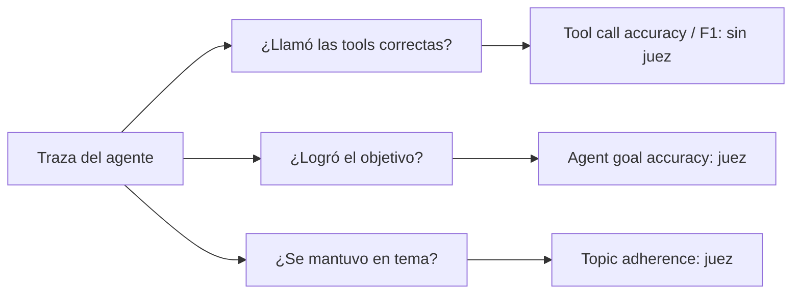

**Objetivo:** evaluar una conversación de agente completa: si llamó las herramientas correctas con los argumentos correctos, si cumplió el objetivo del usuario y si se mantuvo en su tema.

## Idea

En un agente, la unidad a evaluar ya no es una pregunta y una respuesta, sino una **traza**: la secuencia de mensajes del usuario, respuestas del modelo, llamadas a herramientas y resultados de esas herramientas. Ragas la representa como una lista de mensajes tipados:

| Mensaje | Qué contiene |
|---|---|
| `HumanMessage` | Lo que escribió el usuario |
| `AIMessage` | Texto del modelo y, si corresponde, sus `tool_calls` (nombre + argumentos) |
| `ToolMessage` | Lo que devolvió la herramienta |

Sobre esa traza hay tres preguntas distintas, de la más mecánica a la más subjetiva.



### Tool call accuracy

Compara las llamadas que hizo el agente con una lista de **llamadas de referencia**, sin LLM:

1. Extrae los `tool_calls` de todos los `AIMessage` de la traza.
2. Verifica que la secuencia de nombres coincida con la de referencia. En modo estricto el orden importa; si no, se ordenan antes de comparar.
3. Para cada par con el mismo nombre, compara los argumentos por coincidencia exacta.
4. Si el agente hizo menos llamadas que la referencia, el puntaje se penaliza en proporción.

Es determinista y barata: ideal para CI. Su límite es que exige un camino único; si hay varias secuencias válidas, da 0 a las que no escribiste.

**Tool call F1** es la versión flexible: trata las llamadas como conjuntos y calcula precision (cuántas de las que hizo eran esperadas) y recall (cuántas de las esperadas hizo). Sirve cuando el orden no importa y querés distinguir "llamó de más" de "le faltó llamar".

### Agent goal accuracy

¿El agente logró lo que el usuario quería? El juez lee la traza completa, infiere el objetivo del usuario y decide si el estado final lo cumple (1 o 0).

- **Con referencia**: le pasás el resultado esperado ("la orden 812 quedó reembolsada y el cliente recibió el número de caso"). Más confiable.
- **Sin referencia**: el juez infiere también cuál sería el resultado correcto. Sirve para tráfico de producción, con más ruido.

Esta métrica mira el resultado, no el camino: un agente que llegó al objetivo por una ruta distinta a la esperada aprueba igual. Por eso se complementa con tool call accuracy.

### Topic adherence

Para agentes que deben quedarse en un dominio (un bot de soporte que no da consejos legales ni habla de política). Le pasás la lista de **temas permitidos**; el juez extrae los temas de los que habló el agente y si respondió o se negó en cada uno. Con modo precision castiga responder fuera de tema; con recall castiga negarse a temas permitidos; F1 combina ambos.

### Qué métrica para qué

| Querés saber | Métrica | Necesita |
|---|---|---|
| Si eligió y parametrizó bien las tools, con un camino conocido | Tool call accuracy | Llamadas de referencia |
| Si llamó de más o de menos, sin importar el orden | Tool call F1 | Llamadas de referencia |
| Si resolvió el pedido del usuario | Agent goal accuracy | Juez, opcionalmente resultado esperado |
| Si respetó el alcance del producto | Topic adherence | Juez y lista de temas |

## Cómo se implementa

Mismo caso en los dos tabs: el usuario pide reembolsar la orden 812 y el agente llama `refund` con `order_id=812`.

:::tabs
== Ragas
```python
from ragas.messages import AIMessage, HumanMessage, ToolCall, ToolMessage
from ragas.metrics.collections import AgentGoalAccuracyWithReference, ToolCallAccuracy, TopicAdherence

trace = [
    HumanMessage(content="Please refund order 812, it arrived broken."),
    AIMessage(content="", tool_calls=[ToolCall(name="refund", args={"order_id": 812})]),
    ToolMessage(content='{"status": "refunded", "case": "C-2291"}'),
    AIMessage(content="Done. Order 812 was refunded, your case number is C-2291."),
]

tools = await ToolCallAccuracy().ascore(
    user_input=trace, reference_tool_calls=[ToolCall(name="refund", args={"order_id": 812})])
goal = await AgentGoalAccuracyWithReference(llm=judge).ascore(
    user_input=trace, reference="Order 812 refunded and the customer received a case number.")
topic = await TopicAdherence(llm=judge, mode="precision").ascore(
    user_input=trace, reference_topics=["refunds", "orders", "shipping"])

print(tools.value, goal.value, topic.value)
```
== DeepEval
`ToolCorrectnessMetric` compara herramientas llamadas con esperadas (con argumentos y orden si se pide). El objetivo de la tarea se evalúa con `TaskCompletionMetric`, que se ve en el módulo de Evals y observabilidad.

```python
from deepeval.metrics import ToolCorrectnessMetric
from deepeval.models import AnthropicModel
from deepeval.test_case import LLMTestCase, ToolCall, ToolCallParams

case = LLMTestCase(
    input="Please refund order 812, it arrived broken.",
    actual_output="Done. Order 812 was refunded, your case number is C-2291.",
    tools_called=[ToolCall(name="refund", input_parameters={"order_id": 812})],
    expected_tools=[ToolCall(name="refund", input_parameters={"order_id": 812})],
)
metric = ToolCorrectnessMetric(
    model=AnthropicModel(model="claude-opus-5-5"),
    evaluation_params=[ToolCallParams.INPUT_PARAMETERS],
    should_consider_ordering=True,
)
metric.measure(case)
print(metric.score, metric.reason)
```
:::

Para usar estas métricas con un agente real, la traza se convierte desde el formato de tu framework (mensajes de LangGraph, eventos del SDK del proveedor) a la lista de `HumanMessage`, `AIMessage` y `ToolMessage`. Es una función de mapeo que se escribe una vez.

## Errores comunes

- Exigir un único camino con tool call accuracy cuando hay varias secuencias válidas: falsos negativos en cada corrida.
- Evaluar solo el resultado final: el agente puede llegar bien por suerte, o llamando una tool peligrosa de más.
- Usar agent goal accuracy sin referencia en CI: el juez decide qué era lo correcto y el ruido sube.
- No registrar los `ToolMessage`: el juez no puede saber si la acción salió bien.
- Comparar argumentos que cambian en cada corrida (timestamps, ids generados) por coincidencia exacta.

## Preguntas de repaso

- **¿Qué representa una muestra de agente en Ragas?** Una traza: lista de mensajes del usuario, del modelo (con sus llamadas a tools) y de las herramientas.
- **¿Qué diferencia hay entre tool call accuracy y agent goal accuracy?** La primera compara el camino (tools y argumentos) sin juez; la segunda juzga con un LLM si el resultado cumple el objetivo, sin importar el camino.
- **¿Cuándo usás tool call F1 en lugar de accuracy?** Cuando el orden no importa y querés separar llamadas de más (precision) de llamadas faltantes (recall).
- **¿Qué mide topic adherence?** Si el agente responde dentro de los temas permitidos y no se niega a los que sí le corresponden, según el modo elegido.
